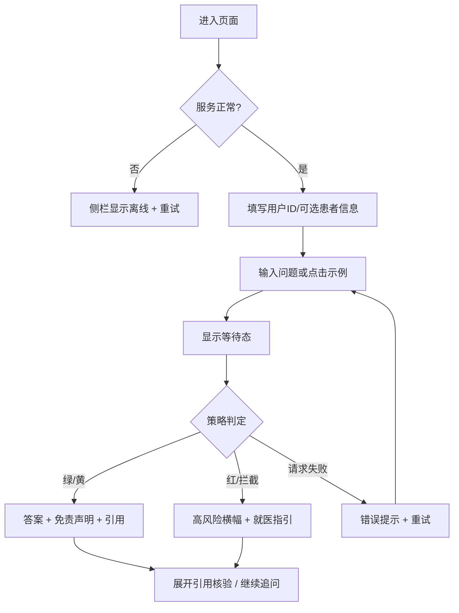

# HealthAssistant 健康智能助手：Web 原型设计方案

> 版本：v1.0　｜　依据：项目 README 与现有前端代码（`App.jsx`、`AssistantMessage.jsx`、`styles.css`、`models.py`）
> 定位：合规优先的 RAG + LLM 健康教育助手，**仅供教育演示，非医疗设备**。

---

## 1. 产品定位与目标用户

| 项 | 内容 |
|---|---|
| 一句话定位 | 基于可信指南、可追溯、有安全边界的健康问答助手 |
| 核心价值 | 回答**有来源**、风险**有分级**、边界**有声明**、操作**有审计** |
| 目标用户 | ① 普通用户：查询日常健康知识；② 慢病人群：结合病史获得更贴切的信息；③ 教学演示者/评审：检查合规机制 |
| 非目标 | 不诊断、不开处方、不替代医生 |

### 典型场景

1. **日常咨询**：“平时如何控制血压？” → 低风险回答 + 引用
2. **带个人背景的咨询**：填写“2 型糖尿病、服二甲双胍” → 回答更有针对性
3. **红旗症状**：“胸痛、呼吸困难” → 触发拦截，给出就医/急救指引（120）
4. **隐私输入**：用户输入姓名、身份证、手机号 → 系统脱敏并提示

---

## 2. 信息架构与用户流程

### 2.1 信息架构

```text
健康智能助手
├── 侧栏（设置与状态）
│   ├── 品牌区
│   ├── 用户与患者信息（用户ID*、年龄、性别、疾病史、用药、过敏史）
│   ├── 服务状态（/healthz）
│   └── 免责声明
└── 主区（对话）
    ├── 空状态：欢迎语 + 示例问题
    ├── 消息列表：用户消息 / 助手消息（分诊徽章、正文、免责声明、引用）
    └── 输入区：多行输入 + 发送
```

### 2.2 主流程



### 2.3 数据与界面对应（来自 `models.py`）

| 接口字段 | 界面元素 |
|---|---|
| `patient.age / sex / conditions / meds / allergies` | 侧栏“患者信息”表单（疾病、用药、过敏用逗号分隔） |
| `answer` | 助手气泡正文 |
| `disclaimer` | 气泡内灰底提示条 |
| `policy.triage_level` (green/yellow/red) | 分诊徽章：低风险 / 中风险 / 高风险·建议就医 |
| `policy.blocked`、`policy.reasons` | “已触发安全拦截”标签 + 原因说明 |
| `citations[].title/chunk/score/source` | 可折叠“引用来源”卡片，显示相关度百分比 |

---

## 3. 界面设计

### 3.1 桌面端线框（≥ 1024px）

```text
┌──────────────────────────────────────────────────────────────────────┐
│ ┌─────────────┐ ┌──────────────────────────────────────────────────┐ │
│ │ ✚ 健康智能助手│ │                                                  │ │
│ │ 合规优先 RAG │ │              💬 您好，请问有什么可以帮您？         │ │
│ ├─────────────┤ │     我会基于可信临床指南提供教育信息，不构成诊断    │ │
│ │ 用户ID *     │ │                                                  │ │
│ │ [user_web  ]│ │   [头痛伴随发烧该如何处理？]                       │ │
│ │ 年龄  性别   │ │   [平时如何控制血压？]                            │ │
│ │ [  ] [ 选择▾]│ │   [我被诊断为2型糖尿病，饮食上要注意什么？]         │ │
│ │ 疾病史       │ │                                                  │ │
│ │ [          ]│ │                                                  │ │
│ │ 用药 / 过敏  │ │                                                  │ │
│ │ [          ]│ ├──────────────────────────────────────────────────┤ │
│ │ ● 服务正常 ⟳ │ │ [ 描述您的健康问题…                    ] [ 发送 ] │ │
│ │ 仅供教育演示…│ │                                                  │ │
│ └─────────────┘ └──────────────────────────────────────────────────┘ │
└──────────────────────────────────────────────────────────────────────┘
```

### 3.2 助手消息卡片结构

```text
🩺 健康助手  [中风险]  [已触发安全拦截]      ← 消息头：身份 + 状态徽章
┌──────────────────────────────────────────┐
│ 回答正文……                                │  ← 主内容
│ ──────────────────────────────────────── │
│ ⚠️ 免责声明：本回答仅供教育参考……          │  ← 灰底弱化，但始终可见
└──────────────────────────────────────────┘
📚 引用来源（3 条）▼                          ← 默认折叠
  [1] 高血压防治指南 · 相关度 86%
      片段……  来源：本地指南库
```

### 3.3 高风险（红旗）状态

```text
┌─────────────────────────────────────────────────────┐
│ 🚨 高风险 · 建议立即就医                              │  ← 红色横幅（对比最强）
│ 检测到：胸痛 / 呼吸困难                               │
│ 请立即拨打 120 或前往最近急诊。                        │
│ [拨打 120 指引]  [查看依据]                           │
└─────────────────────────────────────────────────────┘
（正文降级为“为什么这样提示”，不给出居家处理方案）
```

### 3.4 组件状态清单

| 组件 | 状态 |
|---|---|
| 示例问题按钮 | 默认 / 悬停 / 按下 / 加载中禁用 |
| 输入框 | 空 / 输入中 / 多行自适应 / 禁用（加载时） |
| 发送按钮 | 禁用（空输入或加载中）/ 可用 / “思考中…” |
| 助手消息 | 加载（动画）/ 正常 / 拦截 / 错误 |
| 引用区 | 折叠 / 展开 / 无引用（不显示） |
| 服务状态 | 正常 / 离线 / 检查中 |
| 用户ID | 正常 / 缺失（行内红字提示） |

### 3.5 响应式策略

| 断点 | 布局 |
|---|---|
| ≥ 1024px | 左侧栏 300px + 主区 |
| 640–1023px | 侧栏收为可展开面板（顶部“个人信息”按钮） |
| < 640px | 单栏；侧栏变底部抽屉；输入区固定底部；徽章换行 |

---

## 4. 视觉设计规范

### 4.1 设计令牌（沿用 `styles.css`）

| Token | 值 | 用途 |
|---|---|---|
| `--primary` | `#0e7c86` | 品牌色、主按钮、链接 |
| `--primary-dark` | `#0a5c64` | 悬停/按下 |
| `--bg` | `#f4f7fa` | 页面底色 |
| `--panel` | `#ffffff` | 侧栏、卡片 |
| `--text` / `--text-light` | `#1f2d3d` / `#6b7a90` | 正文 / 辅助 |
| `--border` | `#e3eaf2` | 分割线 |
| `--radius` | `14px` | 统一圆角 |
| `--shadow` | `0 2px 10px rgba(16,42,67,.06)` | 轻阴影 |

### 4.2 语义色（分诊与状态）

| 级别 | 颜色建议 | 文案 | 注意 |
|---|---|---|---|
| green | 绿 | 低风险 | 文案 + 颜色双重表达 |
| yellow | 黄/橙 | 中风险 | 文字用深色保证对比度 |
| red | 红 | 高风险 · 建议就医 | 需配图标与横幅，不只靠颜色 |
| grey | 灰 | 未分级 | 兜底 |

> 说明：此处为健康风险语义色（红=危险），不属于股票涨跌场景，沿用通用红黄绿。

### 4.3 字体与层级

| 层级 | 建议 | 用途 |
|---|---|---|
| H1 | 18–20px / 粗 | 品牌名 |
| H2 | 20–24px / 中粗 | 空状态标题 |
| 正文 | 15–16px / 行高 1.7 | 回答（长文本需宽松） |
| 辅助 | 12–13px / 灰 | 副标题、来源、免责 |
| 字体栈 | PingFang SC / Microsoft YaHei / system-ui | 中文优先 |

### 4.4 CRAP 原则落地对照

| 原则 | 在本方案中的体现 | 待改进 |
|---|---|---|
| **对比** | 红黄绿徽章；主按钮用品牌色；红旗横幅最强 | 红旗提示应升级为置顶横幅 |
| **重复** | 统一圆角/阴影/主色；所有气泡同一结构 | 将令牌沉淀为组件库 |
| **对齐** | 侧栏标签与输入框左对齐；用户消息右、助手消息左 | 表单双列（年龄/性别）需等高 |
| **亲密性** | 正文+免责+引用同属一个消息块；消息间距大于块内间距 | 免责声明与正文间距略收紧 |

---

## 5. 用户体验设计

### 5.1 体验原则

1. **安全先于流畅**：高风险时宁可打断，也要清晰指引
2. **可信可验证**：每个结论可点开看依据
3. **边界透明**：随时能看到“这不是诊断”
4. **隐私最小化**：个人信息全部可选，并说明脱敏
5. **少打扰**：不强制填写患者信息，仅用户 ID 必填

### 5.2 关键交互细则

| 场景 | 设计 |
|---|---|
| 首次进入 | 空状态给 3 个示例；点击即发送，降低上手成本 |
| 发送 | Enter 发送，Shift+Enter 换行；发送后清空并锁定按钮 |
| 等待 | 三点动画 + 阶段文案（“检索指南 → 生成回答”）；超过 10s 提示“仍在处理，可取消” |
| 缺少用户 ID | 行内提示并聚焦输入框（替代 `alert`） |
| 请求失败 | 红色错误卡：原因 + [重试] 按钮，保留用户原问题 |
| 引用 | 默认折叠，显示条数；展开显示标题、片段、来源、相关度 |
| 隐私提示 | 检测到姓名/证件/手机号时，显示“已自动脱敏”小标签 |
| 清空 | 提供“新对话”按钮，清除当前消息但保留患者信息 |

### 5.3 内容与语气

- 使用“建议/可参考”，避免“你得了…”“应该服用…”
- 拦截文案模板：**原因 + 我能做什么 + 建议下一步**
  例：“您描述的症状可能需要及时评估。我无法进行诊断，建议尽快就医；以下是一般性信息……”
- 红旗文案优先给行动（拨打 120），再解释原因

### 5.4 无障碍

- 所有图标按钮提供 `aria-label`；徽章含文字
- 键盘可完成：输入、发送、展开引用、切换示例
- 对比度：正文 ≥ 4.5:1；黄色徽章使用深色文字
- 新消息到达使用 `aria-live="polite"`，红旗使用 `assertive`

### 5.5 UX 检查清单（本原型自评）

| 检查项 | 现状 | 建议动作 |
|---|---|---|
| 系统状态可见 | ✅ 有服务状态与加载动画 | 增加阶段文案 |
| 贴近用户语言 | ✅ 中文友好 | — |
| 用户可控 | ⚠️ 无清空/重新生成/取消 | 增加“新对话”“重新生成”“停止” |
| 一致性 | ✅ 统一变量 | 沉淀组件规范 |
| 防错 | ⚠️ 使用 `alert` | 行内校验 |
| 识别优于回忆 | ✅ 示例问题 | 增加常见主题标签 |
| 错误可恢复 | ⚠️ 仅显示错误文本 | 增加重试按钮 |
| 边界声明 | ✅ 侧栏 + 气泡免责 | 空状态保持 |
| 来源可追溯 | ✅ 引用折叠 | 增加“相关度”说明 |
| 风险分级 | ✅ 徽章 | 红旗横幅 |
| 隐私透明 | ⚠️ 仅在 README 说明 | 界面增加脱敏提示 |
| 响应式 | ⚠️ 侧栏固定宽度 | 抽屉化 |
| 无障碍 | ⚠️ 未验证 | 加 aria 与键盘测试 |

---

## 6. 技术原型落地建议

| 层 | 现有 | 说明 |
|---|---|---|
| 前端 | React + Vite（端口 5173，代理 `/api`） | 组件：`App`、`PatientForm`、`AssistantMessage` |
| 后端 | FastAPI（`/ask`、`/healthz`） | 返回 `answer/disclaimer/citations/policy` |
| 新增组件 | `RiskBanner`、`ErrorCard`、`NewChatButton`、`PrivacyTag` | 对应 3.3、5.2 |


### 迭代计划

| 阶段 | 内容 | 验收 |
|---|---|---|
| P0 | 现有骨架可用：对话、徽章、引用 | 主流程可跑通 |
| P1 | 红旗横幅、错误重试、行内校验、新对话 | 检查清单“⚠️”项清零 |
| P2 | 响应式抽屉、无障碍、隐私提示 | 移动端与键盘走查通过 |
| P3 | 可用性测试（5 人 × 3 任务） | 任务成功率 ≥ 80% |

### 可用性测试任务示例

1. 询问“平时如何控制血压”，找到回答所依据的指南
2. 填写“2 型糖尿病”后提问饮食问题
3. 输入“胸痛并呼吸困难”，描述你看到了什么、下一步会做什么

---

## 7. 学生交付物要求

1. 低保真线框（主界面 + 红旗状态各 1 张）
2. 用户流程图（含异常分支）
3. 设计令牌表（颜色/字体/间距）
4. UX 检查清单自评表（附改进计划）
5. 可运行的前端原型（至少覆盖：空状态、加载态、正常回答、拦截、错误）

---

**免责声明**：本方案用于教学演示，不构成医疗建议。实际医疗场景须经合规、伦理与临床审查。
