# 海上风电场运维智能体 技术设计方案

| 项目 | 内容 |
| --- | --- |
| 文档名称 | 海上风电场运维智能体（Offshore Wind O&M Agent）技术设计方案 |
| 文档版本 | V1.0 |
| 编写角色 | 软件架构师 |
| 输入依据 | 《【案例说明】融合知识图谱、大语言模型和 AI Agent 完成能源领域知识工程工作》 |
| 适用范围 | 海上风电场（100 台风机及升压站）设备故障诊断、检修决策、工单闭环与知识工程 |

---

## 目录

- [1. 概述](#1-概述)
- [2. 技术架构](#2-技术架构)
- [3. AI Agent 工作流与分层结构](#3-ai-agent-工作流与分层结构)
- [4. 系统各层职责与技术选型](#4-系统各层职责与技术选型)
- [5. Agent 安全控制](#5-agent-安全控制)
- [6. 部署架构](#6-部署架构)
- [7. 非功能性设计](#7-非功能性设计)
- [8. 实施路线与风险](#8-实施路线与风险)
- [附录](#附录)

---

## 1. 概述

### 1.1 业务背景

某海上风电场拥有 **100 台风机**，设备包括叶片、齿轮箱、发电机、主轴、变流器、液压系统、塔筒和升压站。项目长期积累了设备台账、设计图纸、技术说明书、检修规程、运行日志、SCADA 数据、报警记录、历史工单、故障案例和专家经验，但存在以下痛点：

| 痛点 | 具体表现 | 对运维的影响 |
| --- | --- | --- |
| 知识分散 | 资料散落在设备管理、生产运行、文档、工单、故障库、传感器平台等多个系统 | 处理一次告警需跨多个系统查询 |
| 名称不统一 | 同一故障被记录为“齿轮箱温高”“齿轮油温超限”“GB 油温异常” | 历史案例检索不全、统计失真 |
| 版本难追踪 | 规程多次修订，设备部件存在更换历史 | 可能引用过期规程，存在安全隐患 |
| 经验难复用 | 处置经验依赖个人，工单结论未结构化沉淀 | 新人上手慢，同类故障重复排查 |
| 海上作业成本高 | 出海受天气窗口、船舶、人员资质约束 | 误判一次即带来高额船舶与停机损失 |

### 1.2 建设目标

建设一个 Web 应用 **“海上风电场运维智能体”**，以知识图谱为知识底座、大语言模型为理解与生成引擎、AI Agent 为任务执行主体，实现：

1. **统一知识管理**：统一管理设备、部件、故障、告警、原因、措施和备件等知识；
2. **自动知识抽取**：从非结构化文档和历史工单中自动提取知识；
3. **智能故障诊断**：根据实时数据和历史案例辅助故障诊断；
4. **检修决策闭环**：自动生成检修建议、工单和知识更新任务；
5. **全程可追溯**：对所有结论提供来源、依据和责任追踪。

### 1.3 设计原则

| 原则 | 说明 |
| --- | --- |
| 知识可信优先 | LLM 输出不直接视为事实，必须经过多层校验与专家审核后才能入图 |
| 证据驱动 | 每个诊断结论必须附带图谱事实、实时数据、规程条款、历史工单等证据及不确定性说明 |
| 人在回路 | 涉及停机、参数修改、带电作业等高风险操作，Agent 只建议不执行，必须人工审批 |
| 职责分离 | “总控 Agent + 专业 Agent”架构，单个 Agent 只拥有完成其职责的最小工具权限 |
| 私有化可控 | 模型与数据私有化部署，生产数据不出场站/企业内网 |
| 云边协同 | 升压站/集控中心部署边缘节点，海缆或网络中断时仍可提供基本查询与诊断 |

---

## 2. 技术架构

### 2.1 总体架构图

系统采用六层架构：**前端交互层 → API 层 → Agent 层 → 模型层 → 数据层 → 基础设施层**，安全与审计作为横切能力贯穿各层。

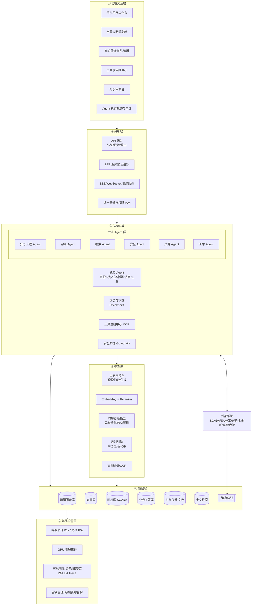

### 2.2 三类核心技术的分工

案例中三者分工可概括为：**知识图谱负责组织知识，大语言模型负责理解和生成，AI Agent 负责规划任务、调用工具并推动执行。**

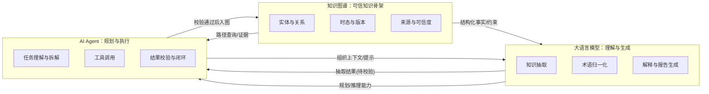

| 维度 | 知识图谱（KG） | 大语言模型（LLM） | AI Agent |
| --- | --- | --- | --- |
| 解决的问题 | 知识如何**结构化表达和关联** | 如何从复杂文本和自然语言中**理解知识** | 如何**围绕目标自主完成**一组知识任务 |
| 核心能力 | 实体关系建模、多跳路径查询、时态版本、来源追溯 | 实体/关系/事件抽取、术语归一化、语义理解、解释生成 | 任务拆解、工具选择、多步推理、结果校验、流程推进 |
| 在本系统中的典型功能 | 告警→部件→历史案例→可能原因→检修措施→备件 的路径推理 | 将检修报告抽取为结构化 JSON；生成带证据的诊断说明 | 接到“WT-023 齿轮箱油温高”后自动查数据、找案例、评风险、生成待审批工单 |
| 优势 | 关系明确、结构稳定、可查询、可追溯 | 处理非结构化资料、自然语言交互 | 连接知识、数据、模型与业务系统 |
| 局限 | 构建成本高，覆盖不了长尾文本知识 | 存在幻觉，结果不能直接作为事实 | 自主性带来安全风险，需要权限与审批约束 |
| 风险控制手段 | 图谱约束校验、本体 Schema | 多层校验、置信度、引用来源 | 分级权限、人在回路、审计与回滚 |

### 2.3 知识图谱的具体功能

#### 2.3.1 风电运维本体（Ontology）

由领域专家与技术人员共同设计。核心实体包括：风场、风机、子系统、部件、传感器、告警、故障、原因、检修措施、备件、人员、作业票、环境条件、文档、工单。

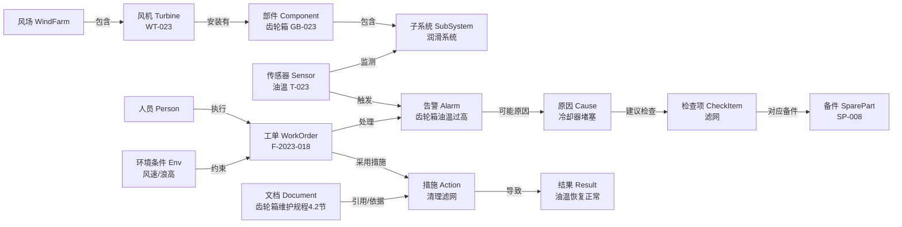

| 关系类型 | 示例 | 用途 |
| --- | --- | --- |
| 属于 / 包含 | 齿轮箱 包含 润滑系统 | 设备结构树、影响范围分析 |
| 安装于 | GB-023 安装于 WT-023（生效 2023-05，失效 2025-08） | 设备履历、部件更换追溯 |
| 监测 | T-023 监测 润滑系统 | 告警 → 测点 → 部件定位 |
| 触发 / 可能原因 / 导致 | 冷却器堵塞 导致 油温过高 | 故障因果推理 |
| 检查 / 更换 / 适用于 | 措施 适用于 某型号 | 检修方案推荐 |
| 发生于 / 引用 | 工单 引用 规程 4.2 节 | 证据链与可追溯 |

#### 2.3.2 图谱功能清单

| 功能 | 说明 |
| --- | --- |
| 设备结构建模 | 风场—风机—子系统—部件—传感器 五级资产树，对齐 EAM 设备编码 |
| 故障知识建模 | 告警、故障模式、原因、检修措施、备件、处理结果的因果链 |
| 时态与版本 | 关系带 `valid_from / valid_to / source / version`，部件更换不覆盖旧数据；规程新版本发布后旧知识标记失效 |
| 来源与可信度 | 每条三元组关联原始文档、页码、工单号、抽取模型版本、审核人、置信度 |
| 多跳路径查询 | 沿“当前告警—对应部件—历史案例—可能原因—检修措施—所需备件”路径推理，而非仅返回关键词文档 |
| 统计特征 | 故障频率、风险等级、平均修复时长（MTTR）等随工单闭环自动更新 |
| 图谱约束校验 | 作为 LLM 抽取结果的“守门员”：如设备与部件关系不存在则拒绝入图 |
| GraphRAG 支撑 | 为 LLM 提供子图上下文，减少幻觉 |

### 2.4 大语言模型的具体功能

| 功能 | 输入 | 输出 | 说明 |
| --- | --- | --- | --- |
| 知识抽取 | 说明书、检修报告、专家记录、工单 | 结构化 JSON（设备/部件/症状/原因/措施/结果/时间） | 按预定义 Schema 输出，见下方示例 |
| 术语归一化 | “齿轮箱温高”“齿轮油温超限”“GB 油温异常” | 标准概念 `GearboxOilTempHigh` | 结合标准词表 + 向量相似度 + LLM 判别 |
| 实体对齐 | 不同系统中的设备/部件名称 | 统一设备编码 | 与 EAM 台账比对 |
| 意图识别 | 用户自然语言问题 | 问题类型（问答/诊断/工单/统计等） | 供总控 Agent 路由 |
| 规划推理 | 任务目标 + 可用工具 | 执行计划（步骤 DAG） | Agent 的“大脑” |
| 解释生成 | 图谱事实 + 时序数据 + 规程 + 案例 | 带证据和不确定性的诊断说明 | 强制引用来源 |
| 工单/报告生成 | 诊断结论、资源信息 | 工单草稿、检修报告、日报 | 模板约束输出 |
| 知识总结 | 已关闭工单 | “故障现象—根因—处理措施—处理效果” | 进入待审核知识队列 |

**抽取示例**（输入：“7 月 12 日，WT-017 在高负荷运行期间出现齿轮箱油温持续升高。现场检查发现冷却器进风口积尘严重，清理滤网并补充润滑油后，温度恢复正常。”）：

```json
{
  "equipment": "WT-017",
  "component": "齿轮箱",
  "symptom": "油温持续升高",
  "condition": "高负荷",
  "possible_cause": ["冷却器积尘", "润滑油不足"],
  "action": ["清理滤网", "补充润滑油"],
  "result": "温度恢复正常",
  "time": "07-12",
  "source": {"doc_id": "RPT-2025-0712-017", "page": 2},
  "confidence": 0.91
}
```

**模型路由策略**：

| 任务类型 | 推荐模型 | 理由 |
| --- | --- | --- |
| 复杂规划、诊断推理、解释生成 | 大参数推理模型（如 Qwen3-235B / DeepSeek-V3 系列私有化） | 推理质量优先 |
| 批量知识抽取、术语归一化、意图识别 | 中小参数模型（如 Qwen3-32B/14B，可领域微调） | 吞吐与成本优先 |
| 边缘离线问答 | 小模型（7B–14B 量化） | 部署在升压站边缘节点 |
| 向量化 / 重排 | bge-m3 / bge-reranker | 中文与专业术语效果好 |

### 2.5 AI Agent 的具体功能

AI Agent 不是单纯的聊天机器人，而是能够**理解目标、拆解任务、选择工具、获取信息、判断下一步并输出结果**的执行主体。

**可调用的工具（通过 MCP 统一注册）**：

| 工具 | 对接系统 | 典型操作 | 读/写 |
| --- | --- | --- | --- |
| `kg_query` | 知识图谱 | 设备结构、因果路径、相似故障 | 读 |
| `kg_upsert_candidate` | 知识图谱（候选区） | 写入待审核知识 | 写（候选区） |
| `doc_search` | 文档 + 向量检索 | 检修规程、说明书条款 | 读 |
| `scada_query` | SCADA / 时序库 | 油温、负荷、振动、油压、冷却风量 | 读 |
| `alarm_query` | 告警系统 | 当前/历史告警 | 读 |
| `workorder_search` | 历史工单系统 | 相似案例 | 读 |
| `rule_eval` | 规则引擎 | 阈值与规程约束判断、风险分级 | 读 |
| `ts_diagnose` | 时序分析模型 | 异常检测、趋势预测、剩余寿命 | 读 |
| `spare_query` | 备件库存系统 | 库存、位置、到货周期 | 读 |
| `resource_schedule` | 人员与船舶调度 | 人员资质、船舶、天气窗口 | 读 |
| `workorder_create_draft` | 工单管理系统 | 创建**待审批**工单草稿 | 写（需审批） |
| `notify` | 消息平台 | 通知值班人员 | 写 |

**典型任务**：接到“分析 WT-023 齿轮箱油温高告警并给出处置建议”后，Agent 自动完成：

1. 查询 WT-023 的设备型号和部件结构；
2. 获取当前油温、负荷、振动、油压和冷却风量；
3. 检索该型号设备的历史相似案例；
4. 查找最新版本的检修规程；
5. 调用规则或诊断模型评估风险；
6. 生成可能原因和检查顺序；
7. 查询所需备件及人员资源；
8. 生成待审批的检修工单；
9. 跟踪处理结果；
10. 将新案例整理为待审核知识。

---

## 3. AI Agent 工作流与分层结构

### 3.1 单个 Agent 的内部分层结构

每个 Agent（总控或专业）均遵循统一的六层内部结构，便于复用与治理：

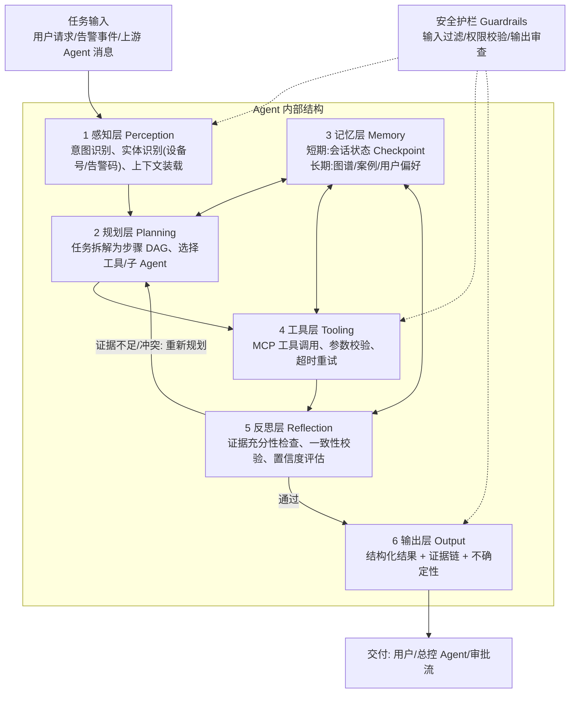

| 层 | 职责 | 关键实现 |
| --- | --- | --- |
| 感知层 | 解析输入，识别意图与关键实体（风机号、部件、告警码、时间范围） | LLM 意图分类 + 正则/词表实体识别 + 术语归一化 |
| 规划层 | 将目标拆解为可执行步骤，决定串行/并行、调用哪个工具或子 Agent | LangGraph 状态图 + Plan-and-Execute / ReAct |
| 记忆层 | 短期记忆保存本次任务状态；长期记忆调用图谱、案例库 | PostgreSQL Checkpointer、Redis、Neo4j、Milvus |
| 工具层 | 按权限调用 MCP 工具，参数 Schema 校验、超时、重试、熔断 | MCP Client + Pydantic 校验 |
| 反思层 | 检查证据是否充分、结论是否与规则/数据冲突、置信度是否达标 | 自检提示 + 规则引擎交叉验证 |
| 输出层 | 生成结构化结果，附证据链、不确定性、建议下一步 | JSON Schema 约束输出 + 模板渲染 |

### 3.2 多智能体协作架构：“总控 Agent + 专业 Agent”

采用案例推荐的 **“总控 Agent + 专业 Agent”** 协作方式，避免让一个大模型承担所有工作，便于**权限隔离、结果审计和故障定位**。

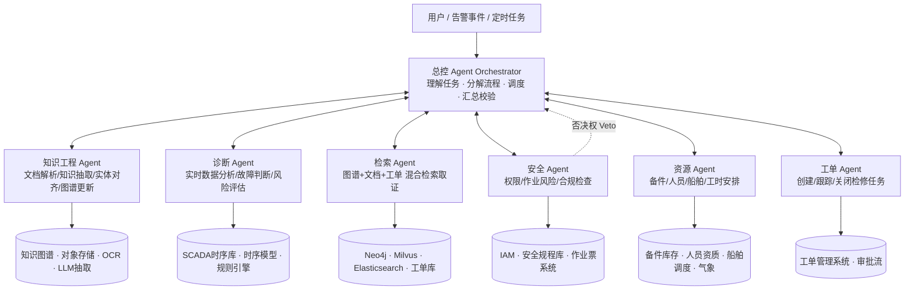

| Agent | 核心职责 | 可用工具（最小权限） | 输出 | 写权限 |
| --- | --- | --- | --- | --- |
| 总控 Agent | 意图识别、任务拆解、调度子 Agent、冲突消解、汇总输出 | 仅可调用子 Agent，不直接访问业务系统 | 最终答复、执行计划 | 无 |
| 知识工程 Agent | 文档解析、知识抽取、术语归一化、实体对齐、图谱更新 | `ocr_parse` `llm_extract` `kg_query` `kg_upsert_candidate` | 候选三元组 + 置信度 | 图谱**候选区** |
| 诊断 Agent | 实时数据分析、异常检测、故障判断、风险评估 | `scada_query` `alarm_query` `ts_diagnose` `rule_eval` | 可能原因排序、风险等级 | 无 |
| 检索 Agent | 从图谱、文档、工单系统寻找证据 | `kg_query` `doc_search` `workorder_search` | 证据包（含来源/页码/工单号） | 无 |
| 安全 Agent | 权限校验、作业风险评估、合规检查（作业票、天气、资质） | `iam_check` `safety_rule_eval` `permit_query` | 通过/有条件通过/否决 + 理由 | 无（拥有否决权） |
| 资源 Agent | 备件、人员、船舶、工时、天气窗口安排 | `spare_query` `resource_schedule` `weather_query` | 资源方案 | 无（仅生成预占建议） |
| 工单 Agent | 创建工单草稿、跟踪状态、关闭并触发知识沉淀 | `workorder_create_draft` `workorder_track` `notify` | 待审批工单 | 工单**草稿** |

**协作模式**：

| 模式 | 适用场景 | 示例 |
| --- | --- | --- |
| 串行（Pipeline） | 后一步依赖前一步结果 | 诊断 → 安全检查 → 资源 → 工单 |
| 并行（Fan-out/Fan-in） | 相互独立的取证任务 | 检索 Agent 与诊断 Agent 同时执行 |
| 条件路由 | 根据风险等级/置信度分支 | 高风险 → 强制人工审批；低置信 → 转人工 |
| 审议/否决 | 安全相关决策 | 安全 Agent 否决则流程终止并升级 |

**通信协议**：Agent 间采用 **A2A（Agent-to-Agent）** 协议风格的标准消息（Agent Card 服务发现 + Task/Message/Artifact），Agent 与工具之间采用 **MCP（Model Context Protocol）**。所有消息携带 `trace_id`、`task_id`、`caller`、`permission_scope`，便于审计与链路追踪。

### 3.3 工作流一：故障告警智能诊断（核心场景）

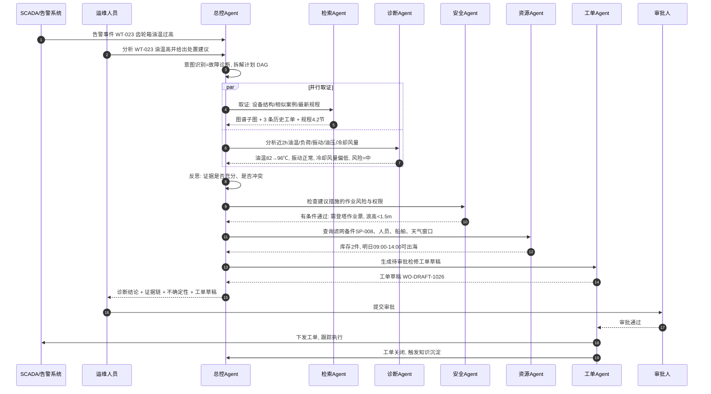

**输出样例**（证据驱动 + 不确定性）：

> WT-023 当前出现齿轮箱油温持续升高。最近两小时内油温由 82℃ 升至 96℃，同时振动值未明显升高，冷却风量低于历史平均水平。结合知识图谱和 3 条历史工单，当前优先怀疑**冷却器堵塞或冷却系统异常**。建议先检查冷却器滤网、进风口和风扇状态，再核查润滑油位。若油温超过规程规定阈值，应由授权人员决定是否降负荷或停机。
> **依据**：《齿轮箱维护规程》4.2 节；工单 F-2023-018。**置信度**：0.78（中）。

### 3.4 工作流二：知识工程流水线（采集 → 建模 → 抽取 → 校验 → 入图）

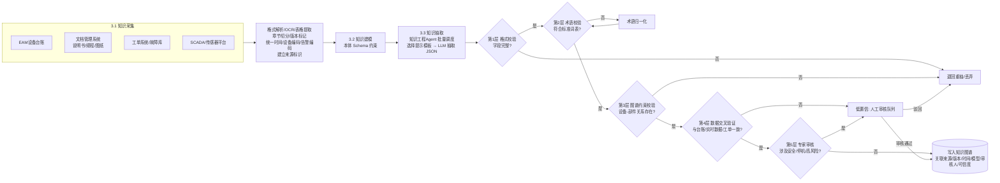

| 校验层 | 校验内容 | 执行者 | 失败处理 |
| --- | --- | --- | --- |
| 1 格式校验 | JSON Schema 字段完整性、类型 | 程序（Pydantic） | 退回重抽（最多 2 次） |
| 2 术语校验 | 设备、故障名称是否在标准词表 | 程序 + LLM 归一化 | 自动归一化后复检 |
| 3 图谱约束校验 | 设备与部件关系是否真实存在 | 图谱查询（Cypher） | 拒绝入图 |
| 4 数据交叉验证 | 与台账、实时数据、历史工单比对 | 知识工程 Agent | 进入人工审核 |
| 5 专家审核 | 涉及安全、停机、高风险操作的知识 | 领域专家 | 通过后入图 / 驳回 |

### 3.5 工作流三：知识更新闭环

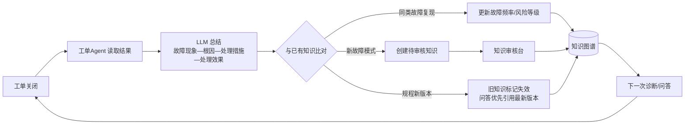

这使知识图谱从一次性建设的静态数据库，转变为**持续吸收现场经验的动态知识系统**。

### 3.6 Agent 任务状态机

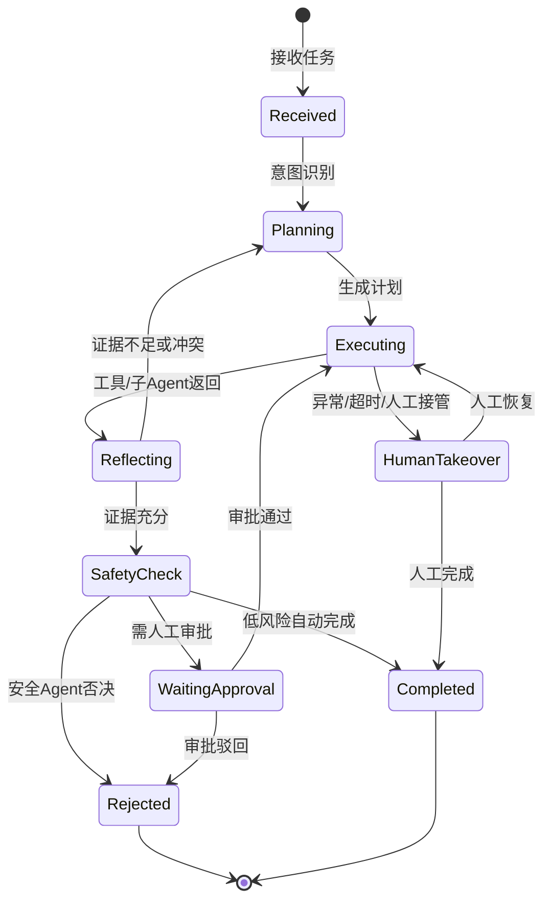

---

## 4. 系统各层职责与技术选型

### 4.1 分层职责总览

| 层级 | 主要职责 | 核心技术选型 |
| --- | --- | --- |
| 前端交互层 | 自然语言交互、告警驾驶舱、图谱可视化、工单审批、知识审核、执行轨迹展示 | React 18 + TypeScript + Vite、Ant Design Pro、AntV G6、ECharts、SSE/WebSocket |
| API 层 | 统一入口、认证鉴权、限流、路由、业务聚合、流式推送、外部系统集成 | APISIX、FastAPI（BFF）、Keycloak（OIDC/RBAC）、OpenAPI 3 |
| Agent 层 | 任务理解与编排、多 Agent 协作、工具调用、记忆管理、安全护栏、人在回路 | LangGraph、MCP、A2A、Temporal、Guardrails |
| 模型层 | 推理/抽取/生成、向量化、重排、时序诊断、规则判断、文档解析 | vLLM + Qwen3/DeepSeek、bge-m3、bge-reranker、PyOD/LSTM-AE、Drools 规则、MinerU/PaddleOCR |
| 数据层 | 知识图谱、向量、时序、业务、文档、全文索引、消息流 | Neo4j、Milvus、TDengine、PostgreSQL、MinIO、Elasticsearch、Kafka、Redis |
| 基础设施层 | 容器编排、GPU 算力、云边协同、可观测性、密钥与网络安全、备份容灾 | Kubernetes/K3s、NVIDIA GPU、Prometheus/Grafana/Loki、OpenTelemetry、Langfuse、Vault、ArgoCD |

### 4.2 前端交互层

**主要职责**：为运维人员、值班长、检修工程师、知识管理员、审批人提供 Web 交互入口。

| 功能模块 | 说明 | 技术要点 |
| --- | --- | --- |
| 智能问答工作台 | 自然语言提问，流式展示 Agent 思考步骤、工具调用和最终答案；答案中引用可点击跳转原文 | SSE 流式渲染、Markdown + 引用卡片 |
| 告警诊断驾驶舱 | 风场地图/风机列表、实时告警、一键“智能诊断” | ECharts 时序曲线、风机状态热力图 |
| 知识图谱浏览 | 以设备为中心查看子图、故障因果路径、时态版本 | AntV G6 力导向图/层级图 |
| 知识审核台 | 展示候选知识、原文高亮、置信度，支持通过/修改/驳回 | 原文 PDF 定位高亮（PDF.js） |
| 工单与审批中心 | 工单草稿审阅、审批、执行跟踪 | 与工单系统双向同步 |
| Agent 执行轨迹 | 每个任务的计划 DAG、工具调用、输入输出、模型版本、耗时 | 时间线 + DAG 可视化 |
| 人工接管面板 | 暂停/恢复/接管/回滚 Agent 任务 | WebSocket 双向控制 |

| 选型项 | 技术 | 理由 |
| --- | --- | --- |
| 框架 | React 18 + TypeScript + Vite | 生态成熟、类型安全、构建快 |
| UI 组件 | Ant Design Pro | 企业中后台组件完备 |
| 图谱可视化 | AntV G6 | 大规模图渲染、交互丰富 |
| 图表 | ECharts | 时序曲线、仪表盘 |
| 状态管理 / 数据请求 | Zustand + TanStack Query | 轻量、缓存友好 |
| 实时通信 | SSE（Agent 流式输出）+ WebSocket（告警推送/人工接管） | 单向流式与双向控制分离 |
| 移动端 | 响应式 H5 / 企业微信工作台 | 海上作业现场查看 |

### 4.3 API 层

**主要职责**：系统唯一入口，负责安全边界、协议转换、业务聚合以及与外部系统的集成。

| 组件 | 职责 | 技术选型 |
| --- | --- | --- |
| API 网关 | 统一入口、TLS 终止、JWT 校验、限流熔断、灰度路由、WAF | Apache APISIX |
| 身份与权限 | 单点登录、RBAC + ABAC（按风场/风机/角色/资质授权） | Keycloak（OIDC）+ OPA 策略引擎 |
| BFF 聚合服务 | 面向前端聚合 Agent、图谱、工单、告警等接口 | FastAPI（Python，异步） |
| 流式推送 | Agent 执行事件、告警推送 | SSE + WebSocket（FastAPI / Redis Pub/Sub） |
| 集成适配器 | 对接 SCADA、EAM、工单、备件、船舶调度系统 | 适配器模式 + Kafka 事件；OPC UA/Modbus 由数据采集侧处理 |
| 接口规范 | 契约优先、版本化 | OpenAPI 3.1、`/api/v1/...` |

**核心接口示例**：

| 方法 | 路径 | 说明 |
| --- | --- | --- |
| POST | `/api/v1/agent/tasks` | 创建 Agent 任务（问答/诊断/知识抽取） |
| GET | `/api/v1/agent/tasks/{id}/stream` | SSE 订阅任务执行过程 |
| POST | `/api/v1/agent/tasks/{id}/approve` | 人工审批（同意/驳回/修改参数） |
| POST | `/api/v1/agent/tasks/{id}/takeover` | 人工接管/暂停/回滚 |
| GET | `/api/v1/kg/subgraph?entity=WT-023&depth=3` | 查询设备子图 |
| GET | `/api/v1/knowledge/candidates` | 待审核知识列表 |
| POST | `/api/v1/knowledge/candidates/{id}/review` | 审核候选知识 |
| GET | `/api/v1/audit/traces/{task_id}` | 查询任务审计轨迹 |

### 4.4 Agent 层

**主要职责**：系统“执行中枢”，负责任务规划、多 Agent 协作、工具调用、状态与记忆管理、安全护栏与人在回路。

| 组件 | 职责 | 技术选型 |
| --- | --- | --- |
| Agent 编排框架 | 状态图编排、条件路由、并行分支、中断/恢复 | **LangGraph**（StateGraph + `interrupt` 人在回路） |
| 多 Agent 通信 | Agent 服务发现、标准化任务消息 | **A2A** 协议（Agent Card + Task） |
| 工具协议 | 工具统一注册、Schema 描述、权限标注 | **MCP**（Model Context Protocol）Server/Client |
| 长流程编排 | 跨天的工单跟踪、定时知识抽取批任务、可靠重试 | **Temporal**（Durable Workflow） |
| 状态持久化 | 任务 Checkpoint、时间回溯、断点续跑 | LangGraph PostgresSaver |
| 记忆管理 | 短期会话记忆、长期案例/偏好记忆 | Redis + PostgreSQL + Milvus |
| 提示词管理 | 提示模板版本化、A/B 评测 | Langfuse Prompt Management |
| 安全护栏 | 输入过滤、提示注入检测、工具权限校验、输出审查 | NeMo Guardrails / 自研规则 + OPA |
| 评测 | 诊断准确率、引用正确率、工具调用成功率 | Langfuse Eval / Ragas + 离线黄金集 |

**GraphRAG 混合检索策略（检索 Agent）**：

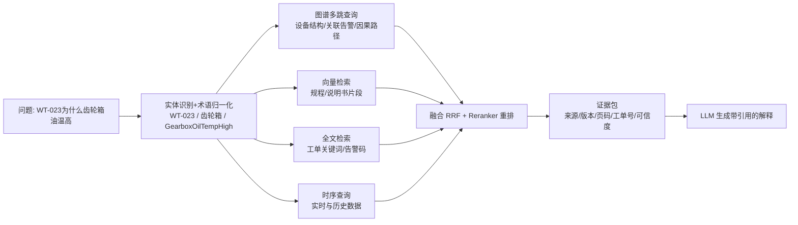

### 4.5 模型层

**主要职责**：为 Agent 提供语言理解、推理生成、向量化、时序诊断、规则判断和文档解析能力，统一通过模型网关对外服务。

| 模型/组件 | 用途 | 技术选型 | 部署方式 |
| --- | --- | --- | --- |
| 推理大模型 | 规划、诊断推理、解释生成 | Qwen3-235B-A22B / DeepSeek-V3 系列（私有化） | vLLM，GPU 集群（集控中心） |
| 抽取模型 | 批量知识抽取、术语归一化、意图识别 | Qwen3-32B（领域 LoRA 微调） | vLLM |
| 边缘模型 | 网络中断时的离线问答 | Qwen3-8B（AWQ 量化） | 升压站边缘 GPU / llama.cpp |
| Embedding | 文档/案例向量化 | bge-m3 | TEI（Text Embeddings Inference） |
| Reranker | 检索结果重排 | bge-reranker-v2-m3 | TEI |
| 时序诊断模型 | 异常检测、趋势预测、健康度评估 | Isolation Forest / LSTM-AutoEncoder / 物理机理模型 | Python 服务（MLflow 管理） |
| 规则引擎 | 阈值、规程约束、风险分级 | Drools 或 Python 规则引擎（规则来自图谱与规程） | 独立服务 |
| 文档解析 | PDF/扫描件/表格/图纸解析 | MinerU + PaddleOCR | CPU/GPU 批处理 |
| 模型网关 | 统一 OpenAI 兼容接口、路由、配额、降级 | LiteLLM | K8s |

**模型治理**：所有模型版本登记于 MLflow / 模型注册表；Agent 每次调用记录模型名称与版本，满足“结论可追溯到模型版本”的审计要求。

### 4.6 数据层

**主要职责**：存储并管理知识、数据、文档、业务状态和审计记录，保证来源可追溯、版本可回溯。

| 数据类型 | 存储 | 技术选型 | 关键设计 |
| --- | --- | --- | --- |
| 知识图谱 | 图数据库 | **Neo4j**（企业版）/ NebulaGraph（国产化备选） | 正式区 + 候选区分离；关系带时态与来源属性 |
| 向量数据 | 向量数据库 | **Milvus** | 按文档类型/风机型号分区，元数据过滤 |
| SCADA 时序数据 | 时序数据库 | **TDengine** / IoTDB | 100 台风机 × 数百测点，秒级写入、降采样 |
| 业务数据 | 关系数据库 | **PostgreSQL** | 任务、审批、工单镜像、用户、审计日志 |
| 原始文档 | 对象存储 | **MinIO** | 文档版本化、哈希校验、不可篡改 |
| 全文索引 | 搜索引擎 | **Elasticsearch** | 工单、告警文本关键词检索 |
| 事件流 | 消息总线 | **Kafka** | 告警事件、工单状态变更、知识更新事件 |
| 缓存 | 内存数据库 | **Redis** | 会话、热点子图、限流计数 |

**知识三元组的溯源元数据**：

| 字段 | 示例 | 说明 |
| --- | --- | --- |
| `source_type` / `source_id` | document / RPT-2025-0712-017 | 来源类型与编号 |
| `source_locator` | page=2, para=3 | 原文定位 |
| `valid_from` / `valid_to` | 2023-05-01 / 2025-08-15 | 生效与失效时间 |
| `version` | 规程 V3.2 | 知识版本 |
| `extract_model` | qwen3-32b-wind-lora@v1.3 | 抽取模型版本 |
| `reviewer` / `review_time` | 张工 / 2026-10-20 | 审核人与时间 |
| `confidence` | 0.91 | 可信度 |
| `status` | candidate / active / deprecated | 知识状态 |

### 4.7 基础设施层

**主要职责**：提供算力、容器编排、云边协同、可观测性和基础安全能力。

| 能力 | 技术选型 | 说明 |
| --- | --- | --- |
| 容器编排 | Kubernetes（集控中心）+ K3s（升压站边缘） | 云边协同，边缘离线自治 |
| GPU 算力 | NVIDIA GPU 节点 + GPU Operator | 推理集群按任务类型划分资源池 |
| CI/CD | GitLab CI + Harbor + ArgoCD | GitOps 发布、镜像签名 |
| 监控告警 | Prometheus + Grafana + Alertmanager | 服务/GPU/队列监控 |
| 日志 | Loki / ELK | 集中日志 |
| 链路追踪 | OpenTelemetry + Jaeger | 跨 Agent、跨服务 `trace_id` 贯通 |
| LLM 可观测 | Langfuse | Prompt、Token、延迟、工具调用、评测 |
| 密钥管理 | HashiCorp Vault | 工具凭证短期动态下发，Agent 不持有长期密钥 |
| 网络安全 | 生产控制大区 / 管理信息大区隔离、单向网闸、零信任 | 满足电力监控系统安全防护要求 |
| 备份容灾 | Velero + 数据库主从 + 对象存储多副本 | RPO ≤ 15 分钟，RTO ≤ 1 小时 |

---

## 5. Agent 安全控制

能源系统涉及生产安全，**Agent 不应完全自主执行高风险操作**。安全控制遵循“最小权限、分级授权、人在回路、全程审计、可接管可回滚”五项原则。

### 5.1 安全控制总体框架

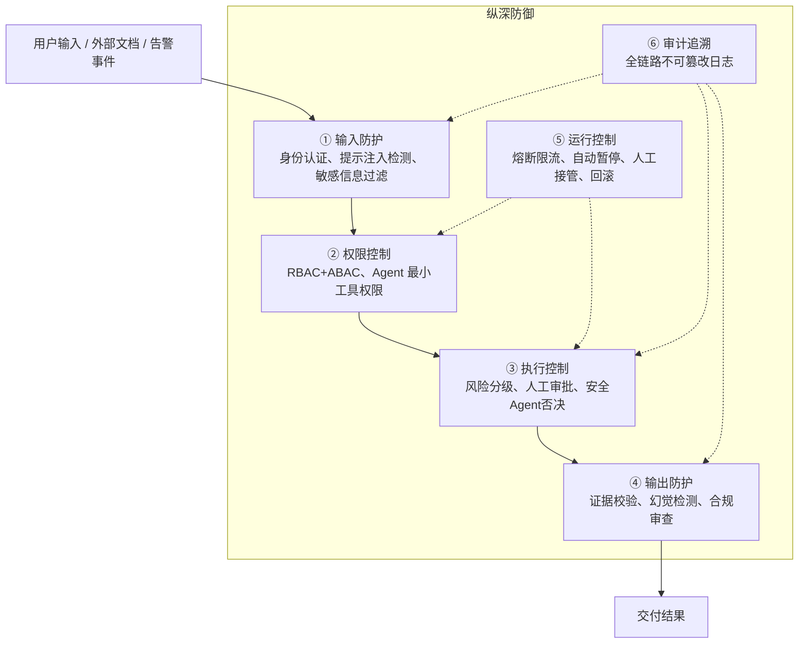

### 5.2 操作风险分级与授权

| 风险等级 | 操作类型 | 示例 | Agent 权限 | 审批要求 |
| --- | --- | --- | --- | --- |
| L0 无风险 | 查询、摘要、知识推荐 | 查询设备结构、规程问答 | 自动完成 | 无 |
| L1 低风险 | 故障诊断与检修建议 | 油温高原因分析 | 生成建议 | **专业人员确认** |
| L2 中风险 | 普通工单、知识入图 | 创建清理滤网工单、写入新故障模式 | 仅生成草稿/候选 | **授权人员审批** |
| L3 高风险 | 停机、参数修改、带电作业、登塔/出海作业 | 降负荷、停机、修改保护定值 | **禁止执行**，仅提示 | **正式审批流程**（作业票、双人确认） |
| L4 不确定 | 证据不足、置信度低、规则冲突 | 无相似案例的新故障 | 停止推理 | **转交人工处理** |

> 设计约束：Agent **不对 SCADA 写入任何控制指令**。控制类操作物理隔离于 Agent 工具集之外，生产控制大区与 Agent 所在的管理信息大区通过单向网闸隔离。

### 5.3 人在回路（Human-in-the-Loop）

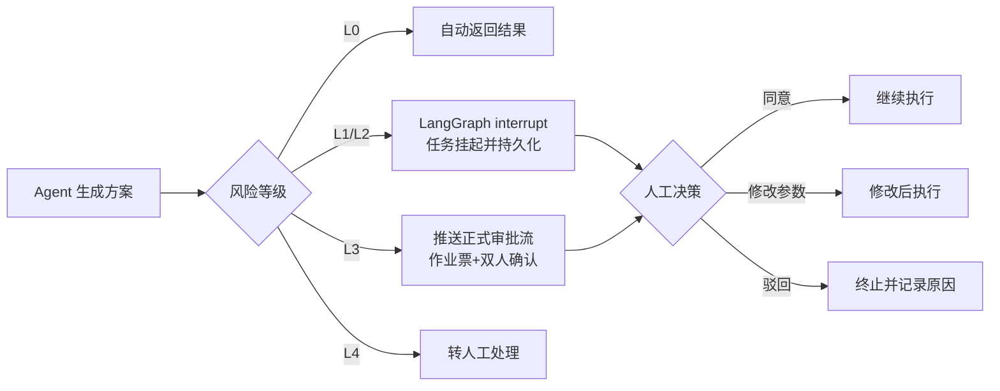

支持的人工干预能力：**人工接管、自动暂停、结果复核、异常升级、操作回滚**。所有任务状态以 Checkpoint 持久化，可回溯到任一步骤重新执行。

### 5.4 Agent 权限隔离

| 控制点 | 措施 |
| --- | --- |
| 最小工具权限 | 每个专业 Agent 只注册其职责所需的 MCP 工具（见 3.2 表）；总控 Agent 不直接访问业务系统 |
| 读写分离 | 默认只读；写操作仅限“候选区/草稿区”，正式生效需人工 |
| 用户身份透传 | Agent 以**发起用户的身份和权限**调用工具（On-Behalf-Of），不能越权访问该用户无权的风场/数据 |
| 动态凭证 | 工具凭证由 Vault 按任务短期签发，任务结束即失效 |
| 参数白名单 | 工具参数经 JSON Schema 校验，设备编码必须存在于台账，禁止批量通配操作 |
| 调用配额 | 单任务最大步数、最大工具调用次数、最大 Token、最大时长，防止失控循环 |

### 5.5 模型与内容安全

| 风险 | 防护措施 |
| --- | --- |
| 提示注入（文档/工单中夹带恶意指令） | 外部内容统一标记为“数据”而非“指令”；注入检测模型；工具调用前二次权限校验 |
| 幻觉 | GraphRAG 约束；强制引用来源；反思层校验结论与数据/规则一致性；无证据则输出“无法确定” |
| 引用过期规程 | 检索默认仅取 `status=active` 的最新版本；输出中标注规程版本号 |
| 数据泄露 | 模型私有化部署；敏感字段脱敏；输出审查过滤账号、IP、设备控制参数 |
| 模型漂移 | 黄金测试集定期回归评测；模型升级灰度发布 |

### 5.6 审计与追溯

每次 Agent 执行任务都记录以下信息，写入 PostgreSQL 审计表并归档到不可篡改的对象存储（WORM）：

| 审计字段 | 说明 |
| --- | --- |
| 任务目标 | 原始请求、发起人、时间、风场/风机范围 |
| 执行计划 | 规划出的步骤 DAG |
| 调用工具 | 工具名、入参、出参摘要、耗时、结果码 |
| 输入数据 | 使用的实时数据窗口与快照 |
| 检索证据 | 图谱三元组 ID、文档片段、工单号 |
| 模型版本 | 各步骤使用的模型及提示模板版本 |
| 输出结果 | 结论、置信度、不确定性说明 |
| 审批过程 | 审批人、决策、修改内容、时间 |
| 最终执行情况 | 工单执行结果、是否回滚 |

---

## 6. 部署架构

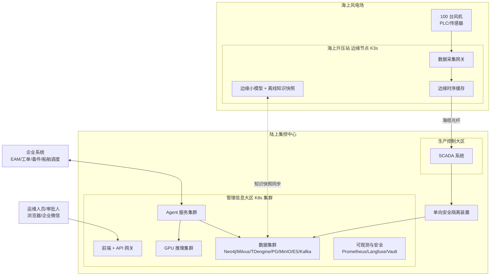

| 部署位置 | 部署内容 | 说明 |
| --- | --- | --- |
| 海上升压站（边缘） | 数据采集网关、边缘时序缓存、量化小模型、离线知识快照 | 海缆/网络中断时仍支持基础查询与规程问答 |
| 集控中心生产控制大区 | SCADA | Agent 不接入此区，数据经单向隔离装置单向流出 |
| 集控中心管理信息大区 | 前端、API、Agent、模型、数据、可观测 | 系统主体 |
| 企业数据中心（可选） | 多风场共享知识图谱、模型训练平台 | 集团级知识复用 |

---

## 7. 非功能性设计

| 类别 | 指标 | 目标值 |
| --- | --- | --- |
| 性能 | 知识问答首字延迟 | ≤ 2 s |
| 性能 | 单次故障诊断端到端耗时 | ≤ 60 s |
| 性能 | 并发用户 | ≥ 200 |
| 吞吐 | 文档批量知识抽取 | ≥ 5,000 页/天 |
| 质量 | 诊断 Top-3 原因命中率 | ≥ 85%（基于历史工单黄金集） |
| 质量 | 答案引用正确率 | ≥ 95% |
| 质量 | 知识抽取准确率（审核通过率） | ≥ 90% |
| 可用性 | 核心服务可用性 | ≥ 99.9% |
| 容灾 | RPO / RTO | ≤ 15 min / ≤ 1 h |
| 安全 | L3 高风险操作 Agent 自动执行次数 | **0** |
| 审计 | Agent 任务审计记录完整率 | 100% |

---

## 8. 实施路线与风险

### 8.1 实施路线

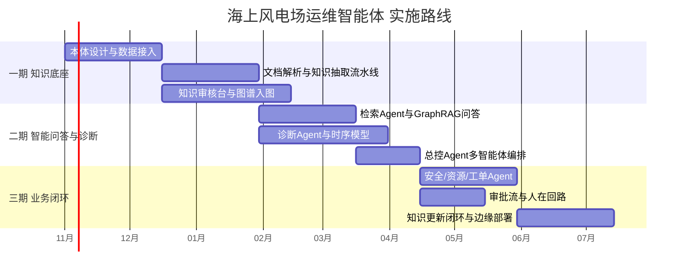

| 阶段 | 目标 | 交付物 | 验收标准 |
| --- | --- | --- | --- |
| 一期 知识底座 | 建立可信知识图谱 | 风电运维本体、知识抽取流水线、知识审核台 | 覆盖齿轮箱/发电机/变流器等核心部件，审核通过率 ≥ 90% |
| 二期 问答与诊断 | 证据驱动的问答与诊断 | 检索 Agent、诊断 Agent、总控 Agent、问答工作台 | 引用正确率 ≥ 95%，Top-3 命中率 ≥ 85% |
| 三期 业务闭环 | 诊断→工单→执行→知识更新闭环 | 安全/资源/工单 Agent、审批流、边缘节点 | 工单草稿采纳率 ≥ 70%，高风险自动执行为 0 |

### 8.2 主要风险与应对

| 风险 | 影响 | 应对措施 |
| --- | --- | --- |
| 历史数据质量差、编码不统一 | 图谱质量低、诊断不准 | 一期优先做数据治理与术语表；低置信知识进入人工审核 |
| LLM 幻觉导致错误建议 | 误判、安全风险 | GraphRAG + 多层校验 + 强制引用 + 人在回路 |
| 专家审核资源不足 | 知识入图速度慢 | 按风险分级审核，低风险知识抽检；审核台提升效率 |
| 海上网络不稳定 | 现场不可用 | 边缘节点 + 离线知识快照 + 小模型 |
| 与既有系统集成复杂 | 工期延误 | 适配器模式 + 事件总线解耦，先只读集成后写集成 |
| 合规要求（电力监控安全防护） | 无法上线 | Agent 部署于管理信息大区，不接入控制指令，单向隔离 |

---

## 附录

### 附录 A：术语表

| 术语 | 说明 |
| --- | --- |
| KG（Knowledge Graph） | 知识图谱，以实体—关系—实体的形式组织知识 |
| LLM（Large Language Model） | 大语言模型 |
| AI Agent | 能理解目标、拆解任务、调用工具并推动执行的智能体 |
| GraphRAG | 结合知识图谱与检索增强生成的问答方法 |
| MCP | Model Context Protocol，模型与工具交互的标准协议 |
| A2A | Agent-to-Agent，智能体之间的通信协议 |
| HITL | Human-in-the-Loop，人在回路 |
| SCADA | 数据采集与监视控制系统 |
| EAM | 企业资产管理系统 |
| MTTR | 平均修复时间 |

### 附录 B：核心总结

> **知识图谱构建可信知识底座，大语言模型完成语言理解和知识抽取，AI Agent 负责任务规划、工具调用和业务执行。**
>
> 三者融合后，形成从**知识采集、建模、抽取、校验、应用到更新**的闭环，把分散的设备数据、技术文档、历史经验和业务流程连接起来，构建**可查询、可解释、可验证、可执行和可持续更新**的海上风电运维知识体系。
