# 行业专业知识智能体开发培训

用 CodeBuddy 等智能体，开发行业专业知识智能体

<div class="pt-8 text-lg opacity-80">
2 天 · 12 学时 · 理论 + 案例 + 实操
</div>

<div class="abs-br m-6 text-sm opacity-60">
按 S 打开演讲者视图，按 O 打开总览
</div>

<!--
开场：自我介绍，说明培训形式：理论约 40%，案例约 25%，实操约 35%。
提醒学员：课前应已准备好 1 个本行业场景 + 5-10 篇可公开示例文档，且不得含涉密或个人隐私数据。
-->

---

# 培训目标

学完后，你应能：

<v-clicks>

1. **讲清楚**：智能体的概念、基本结构、自主程度分类，以及什么任务适合用智能体
2. **看得懂**：分层技术架构，以及 ReAct、Plan-and-Execute、Router、Supervisor、HITL、RAG 等工作流模式
3. **走得通**：按"需求 → 知识工程 → 工具与编排 → 记忆 → 护栏 → 测试 → 上线"完整开发
4. **做得出**：掌握 5 项核心设计，并用 CodeBuddy 搭出可运行原型
   - 任务编排、工具调用、记忆、护栏、专业知识库（RAG + 知识图谱）
5. **能判断**：读懂 TCMRxAgent 与 WindOnMAgent 的取舍，并迁移到自己的行业

</v-clicks>

---

# 日程总览：Day 1

概念、架构、流程与核心技术（6 学时）

| 学时 | 模块 | 主题 | 形式 |
|---|---|---|---|
| 1 | M1 | 智能体的概念、类型与适用性判断 | 理论 |
| 1 | M2 | 工作流模式与技术架构 | 理论 + 图解 |
| 1 | M3 | 智能体开发流程 | 理论 + 案例对照 |
| 1 | M4 | 任务编排、工具调用、护栏 | 理论 + 代码走读 |
| 1 | M5 | 专业知识库与 RAG | 理论 + 演示 |
| 1 | M6 | **实操一**：CodeBuddy 搭建最小行业智能体 | 实操 |

---

# 日程总览：Day 2

知识图谱与记忆、案例拆解、综合实战（6 学时）

| 学时 | 模块 | 主题 | 形式 |
|---|---|---|---|
| 1 | M7 | 知识图谱与记忆 | 理论 + 演示 |
| 1 | M8 | 案例一：TCMRxAgent（中医方证学习智能体） | 案例拆解 |
| 1 | M9 | 案例二：WindOnMAgent（海上风电运维智能体） | 案例拆解 |
| 1 | M10 | 其他类型案例巡礼；评测、治理与上线 | 案例 + 理论 |
| 1.5 | M11 | **实操二**：行业智能体工作坊 | 分组实操 |
| 0.5 | M12 | 成果展示、点评与总结 | 展示 |

---
layout: section
---

# Day 1

概念 · 架构 · 流程 · 核心技术

---
layout: section
---

# M1　概念、类型与适用性判断

1 学时

---

# 什么是智能体（AI Agent）

以**大语言模型**为"大脑"，能够：

- 自主**感知**环境
- 推理与**规划**
- **调用工具**、执行动作
- 根据**反馈**不断调整，直到完成目标

<div class="mt-6 p-4 bg-gray-100 rounded">

**与普通聊天机器人的区别**：自主性 + 工具使用能力 + 多步骤任务执行

</div>

---

# 智能体的五大模块

| 模块 | 作用 |
|---|---|
| 大语言模型（LLM） | 理解任务、推理与决策 |
| 记忆（Memory） | 保存历史对话、中间结果，支持长期任务 |
| 工具（Tools） | 搜索、代码执行、数据库查询等外部能力 |
| 规划（Planning） | 把复杂任务拆成可执行子步骤 |
| 执行与反馈循环 | 执行动作后观察结果，决定下一步 |

---
class: text-sm
---

# 基本结构示例：出差助手

| 模块 | 内容 |
|---|---|
| 用户输入 | 出差人员、地点、时间、事由、交通、费用、项目 |
| 所需知识 | 差旅制度、审批规则、组织架构、预算规则、合规要求 |
| 可用工具 | 员工查询、政策查询、预算计算、项目校验、申请创建、审批提交、状态查询、通知 |
| 决策步骤 | 理解意图 → 提取信息 → 补齐字段 → 查政策 → 算预算 → 合规检查 → 生成草稿 → 用户确认 → 创建并提交 |
| 最终输出 | 政策说明、预算结果、申请草稿、风险提醒、申请单号、审批状态 |

<div class="mt-4 text-center opacity-80">
任何智能体都可以用这五行来拆解
</div>

---
class: text-sm
---

# 按自主程度分类

| 类型 | 工作方式 | 典型场景 |
|---|---|---|
| 被动响应型 | 收到明确指令执行单次任务，不主动规划 | 问答、检索、FAQ |
| 辅助决策型（Copilot） | 用户主导，给建议和草稿，用户确认 | 编程辅助、文档撰写、数据分析 |
| 任务执行型 | 给目标后自行拆解、调用工具，关键节点确认 | 报表生成、工单处理、标准流程 |
| 半自主型 | 只给高层目标，自主规划监控，异常请求人工介入 | 自动化运维、研究分析、供应链 |
| 全自主型 | 独立完成规划、执行、评估、迭代 | 长时监控、交易模拟、科研探索 |
| 多智能体协作 | 多个角色分工，由协调者分配与汇总 | 研发团队模拟、端到端业务流程 |

---

# 自主程度光谱

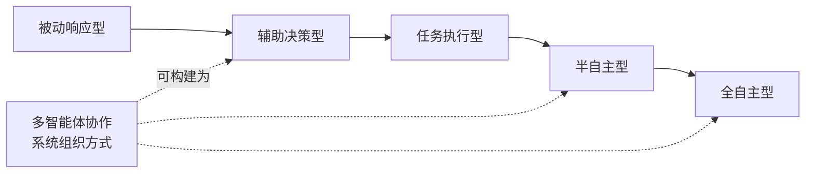

<v-clicks>

- 自主程度越高，对**感知、记忆、规划、安全控制**的要求越高
- 多智能体协作**不是单独的自主等级**，而是一种系统组织方式
- 落地顺序建议：被动响应 → 辅助决策 → 任务执行 → 半自主

</v-clicks>

---
class: text-sm
---

# 判断：任务是否适合用智能体

**看六个方面**：是否需要理解意图、调用多工具、动态决策、多步骤执行、能否容错（风险）、是否需要人工审批

| 任务 | 适合吗 | 更合适的实现 |
|---|---|---|
| 查询员工报销制度 | 部分适合 | 知识库问答或轻量智能体 |
| 自动查天气并安排出行 | 适合 | 多工具协同智能体 |
| 分析销售数据并生成报告 | 适合 | 数据分析智能体 |
| 自动审批所有财务申请 | **不适合完全自动化** | 规则引擎 + 智能体辅助 + 人工审批 |
| 根据客户需求推荐产品 | 适合 | 推荐型智能体 |

<div class="mt-4 p-3 bg-yellow-50 rounded">

高风险、高责任的决策：**智能体辅助 + 规则约束 + 人工确认**

</div>

---

# 课堂练习 1

<div class="text-lg">

把你所在行业的 **3 个业务场景**填入下表（5 分钟，随后分享）

</div>

| 业务场景 | 适合的智能体类型 | 自主程度 | 风险边界（哪些不能自动做） |
|---|---|---|---|
| 1 | | | |
| 2 | | | |
| 3 | | | |

<!--
课堂小测：给 5 个业务场景，现场判断类型。M1 结束时做。
-->

---
layout: section
---

# M2　工作流模式与技术架构

1 学时

---

# 十种常见工作流模式

<div class="grid grid-cols-2 gap-x-8 text-lg">
<div>

1. 基础循环：感知—思考—行动
2. **ReAct**：推理与行动交替
3. **Plan-and-Execute**：先规划后执行
4. **Router**：任务路由到专用智能体
5. 并行智能体

</div>
<div>

6. **Reflection**：生成—评审—修正
7. **Supervisor**：多智能体协作
8. **Human-in-the-Loop**：人工审批
9. **RAG 智能体**：检索增强生成
10. 工具调用与异常恢复

</div>
</div>

<div class="mt-6 opacity-80">
每种模式都从三个角度理解：适用场景、优点、缺点
</div>

---

# 模式 1：基础循环

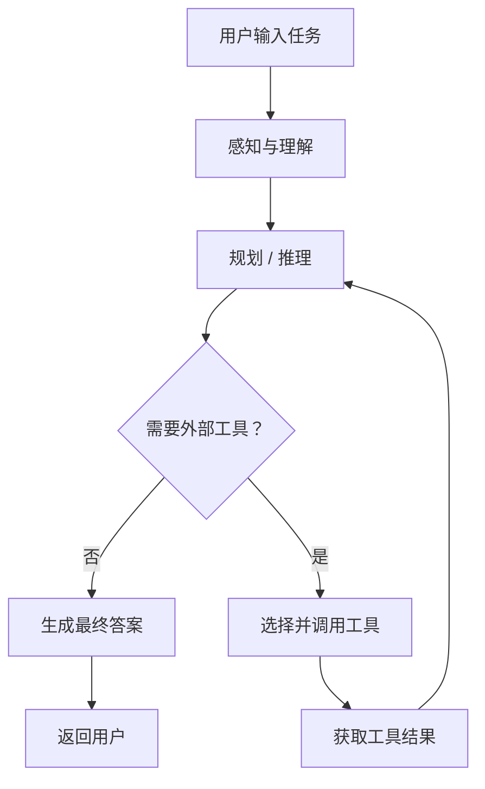

结构简单；缺点：规划、执行、校验混在一起，复杂任务可控性较弱

---
layout: two-cols
---

# 模式 2：ReAct

推理（Reasoning）+ 行动（Acting）

```text
Thought → Action → Observation
   → Thought → Action → ...
```

**适用**：搜索问答、数据库查询、浏览器操作、API 调用

**优点**：灵活，可按实时结果调整

**缺点**：

- 容易无限循环
- 推理不稳定
- 工具调用次数与成本难控

<div class="p-2 bg-red-50 rounded mt-3">
必须设置：最大步数、超时、异常处理
</div>

::right::

<div class="pl-6 pt-16">

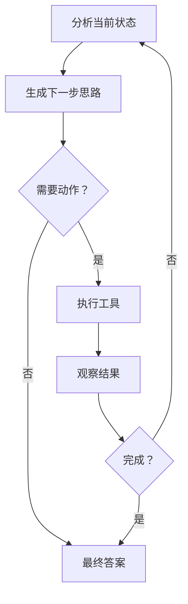

</div>

---
layout: two-cols
---

# 模式 3：Plan-and-Execute

把**任务分解**与**具体执行**分开

**适用**：研究报告、复杂数据分析、多步骤自动化、需展示执行计划

**优点**：结构清晰；便于监控；支持失败重试与局部恢复；便于人工审核计划

**缺点**：初始计划可能不准；环境变化需重规划；简单任务有额外开销

::right::

<div class="pl-6 pt-8">

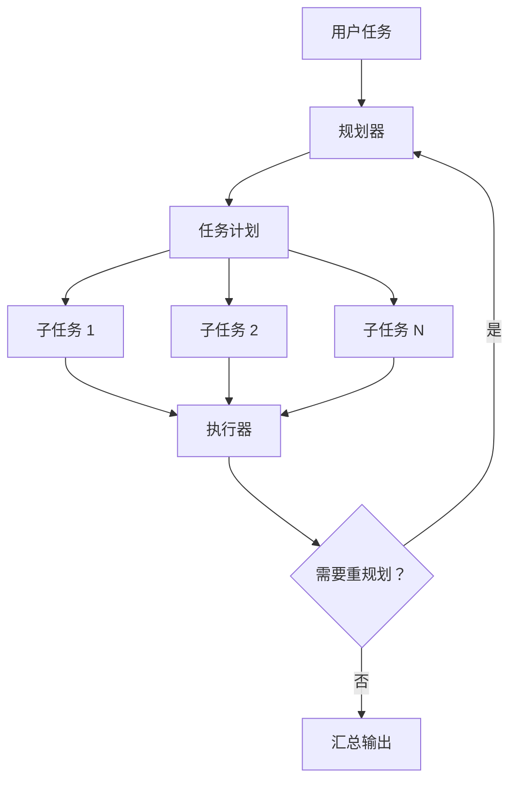

</div>

---
class: text-sm
---

# 模式 4-6：Router · 并行 · Reflection

| 模式 | 做法 | 适用场景 | 要点 |
|---|---|---|---|
| **Router** | 路由器判断意图，分发给专家智能体 | 多业务入口、不同领域 | 加**置信度**与**人工兜底** |
| **并行智能体** | 多个智能体同时处理独立子任务 | 子任务独立、追求速度 | 需要失败处理与结果汇总 |
| **Reflection** | 生成 → 评审 → 修正 | 对输出质量要求高 | 可用双智能体评审；设定评审指标与次数上限 |

---
class: text-sm
---

# 模式 7-10：Supervisor · HITL · RAG · 异常恢复

| 模式 | 要点 |
|---|---|
| **Supervisor** | 主管负责分配任务、汇总结果、处理冲突；与 Router 的区别：Supervisor **持续协调**，Router 只做一次分发 |
| **Human-in-the-Loop** | 资金、删除、发布等**不可逆操作**必须审批；需设计审批节点、超时与升级 |
| **RAG 智能体** | 依赖企业文档或专业知识；工具包括检索、重排、引用、权限过滤 |
| **异常恢复** | 超时、重试、降级、熔断；上线生产环境必须叠加 |

---

# 选型速查

| 你的任务特点 | 建议工作流 |
|---|---|
| 简单工具调用，步骤少 | 基础循环 |
| 边查边想，路径不确定 | ReAct（**加步数上限**） |
| 目标明确、步骤多、需展示计划 | Plan-and-Execute |
| 多业务入口、不同领域 | Router |
| 子任务独立、追求速度 | 并行智能体 |
| 对输出质量要求高 | Reflection |
| 需要多种角色持续协作 | Supervisor |
| 涉及资金、删除、发布等不可逆操作 | Human-in-the-Loop |
| 依赖企业文档或专业知识 | RAG 智能体 |
| 上线生产环境 | 全部叠加"异常恢复"与可观测性 |

---

# 统一分层技术架构

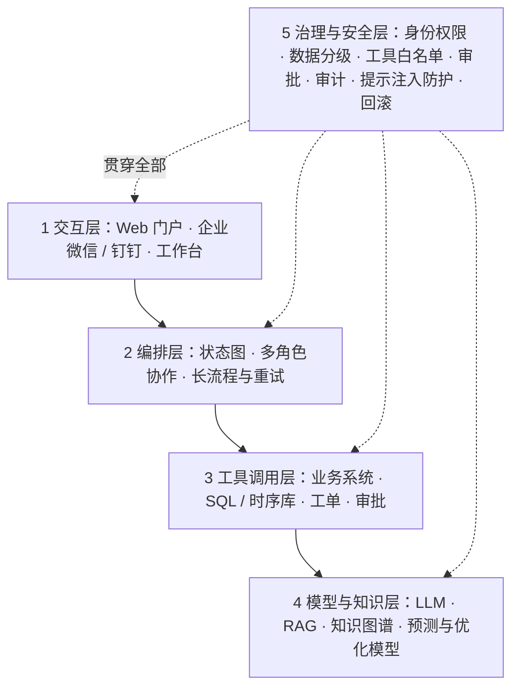

---
class: text-sm
---

# 框架与协议概览

| 层次 | 框架 / 协议 | 作用 |
|---|---|---|
| 编排 | **LangGraph** | 状态图、检查点、`interrupt()` 审批、多智能体拓扑 |
| 编排 | Microsoft Agent Framework | 基于图的 workflows，支持 A2A、MCP |
| 编排 | OpenAI Agents SDK / Google ADK | handoffs、guardrails、tracing / 顺序、并行、循环智能体 |
| LLM 应用 | LangChain / LlamaIndex | 模型封装、检索器、向量库集成 |
| 工具协议 | **MCP** | 智能体 ↔ 工具 / 数据（纵向） |
| 智能体间协议 | **A2A** | 智能体 ↔ 智能体（横向），与 MCP 互补 |
| 持久化 | PostgresSaver 等 | 检查点持久化（MemorySaver 仅调试） |

<div class="mt-3 p-2 bg-red-50 rounded">

**AutoGen 已归档不再维护，不要新开项目；框架版本变化快，务必固定版本并读当前文档**

</div>

---

# 贯穿所有模式的工程原则

<v-clicks>

- **把自由推理变成可控状态机**
  状态 → 节点 → 转移条件 → 工具权限 → 超时重试 → 审批节点 → 结果校验
- **循环必须设边界**
  最大步数、重试次数、工具调用次数、Token、执行时间
- **区分三类失败**
  规划失败 → 重新拆解；执行失败 → 重试 / 替换 / 降级；质量失败 → Reflection
- **统一结构化输出**
  status / summary / evidence / warnings / next_action
- **可观测**
  任务耗时、步数、工具成功率、重试率、人工介入率、完成率、Token 费用

</v-clicks>

---
layout: section
---

# M3　智能体开发流程

1 学时

---

# 通用八步法

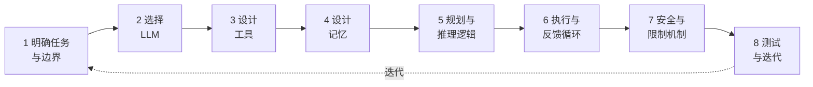

<v-clicks>

- 范围定义越清晰，后续设计越简单
- 工具描述写得越清楚，LLM 调用越准确（名称、功能、输入、返回）
- 短期记忆放上下文；长期记忆用向量库（即 RAG）
- 安全：最大步数、超时、危险操作人工确认

</v-clicks>

---

# 行业智能体的扩展流程

在通用八步法前后，补上行业必需的环节：

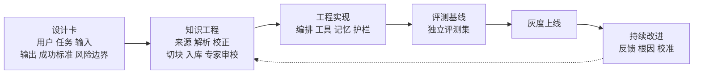

<div class="mt-4 text-sm opacity-80">
持续改进闭环（WindOnMAgent）：反馈收集 → 根因分析 → 参数校准 → 黄金集门禁（≥85%）→ 灰度 / 全量，周期 ≤ 30 天
</div>

---

# 设计卡：六个必答问题

| 设计内容 | 要回答的问题 |
|---|---|
| **用户对象** | 谁使用智能体 |
| **业务任务** | 具体完成什么 |
| **输入信息** | 用户提供哪些数据 |
| **输出结果** | 用户最终得到什么 |
| **成功标准** | 怎样评价效果（可度量） |
| **风险边界** | 哪些事情不能自动完成 |

<!--
示例：电力交易多智能体的风险边界——不得在未经授权和人工审批的情况下提交交易；数据缺失或置信度过低时不得生成确定性指令；不得突破物理约束。
-->

---

# 用 CodeBuddy 开发的工作方式

<v-clicks>

1. **先写需求与设计文档**，再让 CodeBuddy 分模块生成
2. 提示词 = **角色 + 约束 + 验收标准**
3. **小步迭代**，每一步都能运行
4. 让 CodeBuddy **同时生成测试**
5. **人工审查关键代码**：护栏、权限、数据写入、密钥处理
6. 初学者策略：先做 1-2 个工具的最小版本，跑通闭环，再加记忆、知识库、护栏

</v-clicks>

<div class="mt-4 p-3 bg-blue-50 rounded text-sm">

**对照**：TCMRxAgent 与 WindOnMAgent 都是先有设计方案，再落地实现。WindOnMAgent 的 README 附有"与设计文档的差异"，是诚实交付的范例。

</div>

---
layout: section
---

# M4　任务编排 · 工具调用 · 护栏

1 学时

---
layout: two-cols
---

# 任务编排

**意图识别 → 子任务拆解 → 选择工具链**

**TCMRxAgent 规划器**

- 规则规划（默认）
- LLM 规划：**只能从白名单工具中选**，失败回退规则
- 不同意图对应不同工具链

**WindOnMAgent**

- 总控 + 7 个专业智能体
- **总控没有任何业务工具**，只负责调度

::right::

<div class="pl-6 pt-16 text-sm">

| 意图 | 工具链 |
|---|---|
| recommend | rank → kg_expand → retrieve → clauses → safety |
| explain | retrieve → clauses |
| compare | kg 鉴别 → retrieve → clauses → safety |
| modify | modifications → kg_expand → retrieve → safety |
| herb | herb_info → retrieve → clauses |
| safety | safety_review → clauses |

</div>

---

# 工具调用：设计要点

<div class="grid grid-cols-2 gap-8">
<div>

**工具四要素**

- 名称
- 描述
- 参数 Schema
- 返回格式

**注册表式工具**

统一的耗时、错误处理、轨迹记录

</div>
<div>

**WindOnMAgent 工具注册中心**

- Schema 校验
- 最小权限
- 配额
- 熔断
- 审计

**读写分离**：只读与写操作分开

</div>
</div>

<div class="mt-6 p-3 bg-red-50 rounded">

WindOnMAgent **没有任何向 SCADA 写控制指令的工具**。停机、降负荷、改参数等 L3 操作只给提示。

</div>

---

# 护栏：三道关

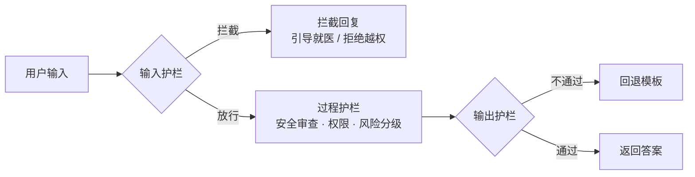

| 关卡 | TCMRxAgent | WindOnMAgent |
|---|---|---|
| 输入 | 急症、自伤、提示注入、越权停药 | 输入护栏、权限校验 |
| 过程 | 孕妇、儿童、老人、基础病、毒性药 | 风险分级 L0-L4，RBAC + ABAC |
| 输出 | 核验条号与方名，剥离克数 | L3 双人签批，哈希链审计 |

---

# 风险分级与人在回路（WindOnMAgent）

| 级别 | 处理 |
|---|---|
| L0-L2 | 按级别分层处理，L2 需审批 |
| **L3** | 智能体**仅提示**；工单须**作业票 + 两名不同审批人双签** |
| **L4** | 低置信度时转人工 |

<v-clicks>

- 权限：RBAC + ABAC（例如 operator2 仅能看二号风场）
- 审计：哈希链（WORM），触发器禁止 UPDATE / DELETE，可用 `/audit/verify` 校验
- 响应：≥ 二级预警自动生成紧急工单，响应时长计入 KPI，超时升级通知

</v-clicks>

---

# 课堂讨论

<div class="text-2xl mt-16 text-center">

你的行业里，哪些动作

**智能体绝对不能自己做？**

</div>

<div class="mt-10 text-center opacity-80">
列出"红线清单"，每组分享 1 条（5 分钟）
</div>

---
layout: section
---

# M5　专业知识库与 RAG

1 学时

---

# 为什么行业智能体离不开知识库

<div class="grid grid-cols-2 gap-8">
<div>

**大模型的三个问题**

- 幻觉
- 知识时效
- 专业性不足

</div>
<div>

**专业知识的三种形态**

- **结构化**：关系表
- **向量化**：文本块，供 RAG
- **图结构**：知识图谱

</div>
</div>

<div class="mt-8 p-3 bg-blue-50 rounded text-center">
TCMRxAgent 的 <code>ingest.py</code> 一次摄取，写入同一个库，同时产生三种形态
</div>

---

# RAG 全链路

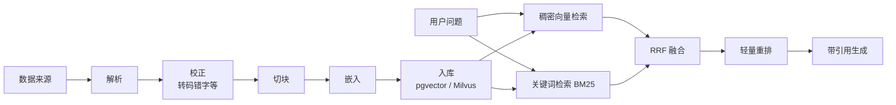

- 重排策略示例：命中候选方加分、**原文条文优先**
- WindOnMAgent GraphRAG：默认只检索 `status=active` 的**有效规程版本**

---

# TCMRxAgent 的语料

| 来源 | 内容 |
|---|---|
| 伤寒论原文 | 398 条（GB18030 编码，需修正转码错字，如"大盒饭"→大便） |
| 方剂整理 | 112 方：组成、煎服法、条文症状、方族比较、方后注、林亿按语 |
| 古籍语料 | 8 部：柯琴、尤怡、徐灵胎注家、《金匮要略》《汤头歌诀》《神农本草经》等 |
| 手工整理 | 症状词表、药物简表、六经概要、安全规则、112 方辨证画像 |

<div class="mt-3 p-2 bg-yellow-50 rounded text-sm">
手工整理部分未经中医专家审校，上线前必须由专业人员审校
</div>

---

# 嵌入模型与常见问题

<div class="grid grid-cols-2 gap-8">
<div>

**嵌入模型**

- 案例默认"哈希 n-gram"：零依赖，语义弱
- 生产建议 bge-m3 等语义嵌入
- 换模型后须**同步维度并重新摄取**

</div>
<div>

**常见问题 → 对策**

| 问题 | 对策 |
|---|---|
| 语料噪声 | 校正与清洗 |
| 切块不当 | 按条文 / 章节切 |
| 引用不实 | 输出核验 |
| 缺权限过滤 | 检索前过滤 |
| 版本过期 | 版本状态管理 |

</div>
</div>

<div class="mt-4 text-center p-2 bg-blue-50 rounded">
RAG 的价值是 <b>可引用、可追溯</b>：回答引用的内容必须能在检索证据里找到
</div>

---
layout: section
---

# M6　实操一

用 CodeBuddy 搭建最小行业智能体（1 学时）

---

# 实操一：目标与步骤

**目标**：1 小时内跑通 输入 → 规划 → 工具调用 → RAG → 带引用输出

| 时间 | 步骤 |
|---|---|
| 10 min | 选场景；准备 5-10 篇示例文档；配置 CodeBuddy 与模型 API |
| 35 min | 让 CodeBuddy 分步生成：骨架 → 解析切块入库 → 检索工具 → 1-2 个业务工具 → 简单规划器 → 带引用合成 → 命令行或简单页面 |
| 10 min | 加最小护栏：最大步数、输入拒答、输出必须带引用 |
| 5 min | 每组展示一次问答，指出一个失败案例 |

---

# 提示词模板

````md
你是资深 Python 工程师。请为"〔行业场景〕"实现最小智能体：

1. 读取 docs/ 下文档，切块并存入 〔向量库〕
2. 提供 search_docs(query) 工具，返回片段与来源
3. 规划器先判断意图，再决定是否调用工具
4. 答案必须标注来源；检索不到依据时拒答
5. 为每个模块写单元测试

先给出目录结构，我确认后再逐个实现。
````

**交付物**：可运行最小原型 + 一页"遇到的问题与改进想法"

<!--
基础较弱的班级：由讲师提供骨架代码，学员补全。
-->

---
layout: section
---

# Day 2

知识图谱与记忆 · 案例 · 综合实战

---
layout: section
---

# M7　知识图谱与记忆

1 学时

---

# 知识图谱：何时需要、如何设计

<div class="grid grid-cols-2 gap-8">
<div>

**何时需要**

- 关系推理、多跳查询
- 鉴别比较
- 反向召回（症状 → 方剂）
- 溯源

</div>
<div>

**设计步骤**

1. 本体：实体类型 + 关系类型
2. 抽取
3. 校验
4. 入库
5. 查询

</div>
</div>

---

# 两个案例的图谱

| | TCMRxAgent | WindOnMAgent |
|---|---|---|
| 节点 | Formula、Herb、Feature、Channel、Pathogenesis、Treatment、Family、Modification | 设备、部件、故障模式、规程等（以 `ontology.py` 为准） |
| 关系 | COMPOSED_OF、TREATS、IN_CHANNEL、DERIVED_FROM、CONTRASTS_WITH、HAS_MODIFICATION、CONTRAINDICATED_FOR | 故障因果、部件履历、规程引用等（以源码为准） |
| 特色 | 方族来历、变方、两方鉴别、反向召回、前端子图可视化 | **时态、版本、溯源、约束校验**；部件更换保留履历，规程新版本使旧引用失效 |
| 实现 | PostgreSQL `kg_nodes / kg_edges` | PostgreSQL `kg_entities / kg_relations`，递归查询做多跳 |

---

# LLM 抽取图谱：五层校验

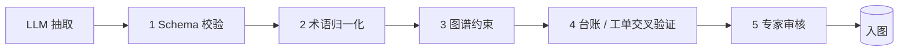

<div class="mt-6 p-3 bg-red-50 rounded text-center text-lg">
LLM 的输出<b>不直接入图</b>
</div>

---

# 记忆：三层设计

| 层次 | 内容 | 作用 |
|---|---|---|
| **工作记忆** | 会话槽位：已确认 / 否认的症状、脉舌、患者信息、焦点方剂、已追问项 | 多轮追问不丢病例 |
| **逐轮记录** | 每轮问答（已脱敏） | 回溯与审计 |
| **长期记忆** | 咨询摘要向量 + 学习画像 | 跨会话个性化；按语义召回历史 |

**配套隐私措施**：PII 脱敏 · 游客 / 登录两种身份 · 一键删除个人数据（含长期记忆）· 会话与用户严格隔离

---

# RAG · 知识图谱 · 记忆如何协作

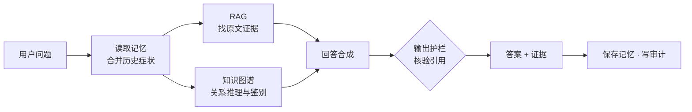

- RAG 找"**原文证据**"
- 图谱做"**关系推理与鉴别**"
- 记忆保证"**多轮连续**"

---

# 课堂讨论

<div class="text-2xl mt-12 text-center">

你的行业最需要知识图谱回答哪类问题？

</div>

<div class="mt-10 text-center">
画出 <b>5 类实体、6 种关系</b> 的初版本体（8 分钟）
</div>

---
layout: section
---

# M8　案例一：TCMRxAgent

中医方证学习智能体 · 1 学时

---

# 案例定位与边界

**辅助决策型**：用户描述症状、舌脉，系统给出《伤寒论》可能对应的方剂，**说明开方原因**，支持追问

<div class="grid grid-cols-2 gap-8 mt-4">
<div>

**功能**

- 症状求方：Top-3，逐项对应方证要点
- 开方理由：条文、病机、方义、鉴别
- 追问：生成"能区分候选方"的追问
- 方剂追问：为什么用 / 比较 / 加减 / 禁忌
- 方剂百科（112 首）
- 可见检索证据、图谱、**执行轨迹**

</div>
<div>

**边界**

- 教学辅助，**不是诊疗系统**
- 不给现代克数，只引用原文"两 / 升 / 枚"
- 不建议自行抓药服药
- 急危重症拦截并引导就医

</div>
</div>

---

# 总体架构

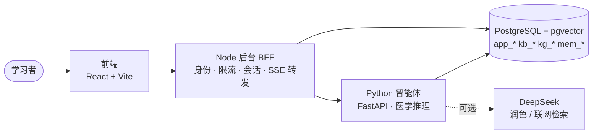

- 两个后端服务**各写各的表**：后台写 `app_*`，智能体写 `kb_* / kg_* / mem_* / agent_audit`
- 外部服务不可用时，**自动降级为纯本地模板模式**

---

# 一次问答的阶段

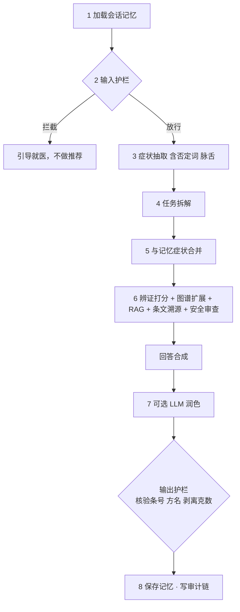

---
class: text-sm
---

# 五大技术点对照

| 技术点 | 位置 | 实现 |
|---|---|---|
| **任务拆解** | `core/planner.py` | 规则规划识别意图并拆子任务；`PLANNER_MODE=llm` 时由 LLM 规划，**仅白名单工具**，失败回退规则 |
| **工具调用** | `core/tools.py` | 注册表式工具：`extract_symptoms` `rank_formulas` `kg_expand` `retrieve` `clauses` `safety_review` `herb_info`；每次调用写入轨迹 |
| **记忆** | `core/memory.py` | 工作记忆 + 逐轮记录（脱敏）+ 长期记忆（向量摘要 + 学习画像） |
| **护栏** | `core/guardrails.py` | 输入 / 用药安全 / 输出三道关 |
| **专业知识库** | `knowledge/` | 398 条原文 + 112 方档案 + 8 部古籍（RAG）+ 知识图谱 |

---

# 设计亮点：可解释的辨证打分

```text
得分 = Σ命中权重 + 近义部分分 + 脉舌加分 − 冲突/禁忌惩罚
```

<v-clicks>

- 每个方剂有手工整理的**辨证画像**：核心症状权重（1-3）、要求"无"的症状、排除症状、典型脉舌、鉴别要点、禁忌
- 置信度 = 覆盖率，随证据量收敛；单一症状只得到很低置信度并**触发追问**
- **LLM 不参与打分**：医学结论可复现、可审计
- LLM 润色必须通过输出护栏，不通过自动回退模板
- 联网结果只作参考证据：不参与打分，查询词**不带用户原话与个人信息**，抓取拒绝内网地址（防 SSRF）

</v-clicks>

---

# 局限与反思（讲师务必强调）

<v-clicks>

1. **知识未经专家审校**：画像权重、药物简表、安全规则为归纳整理
2. **18/18 的评测只是回归基线**：用例与画像出自同一人，且调过权重，**不能当作真实准确率**；真实质量需中医师构造独立、带噪声的病例集
3. 范围仅限《伤寒论》112 方
4. 症状抽取基于词表，口语覆盖有限
5. 默认嵌入语义弱
6. Docker 配置**未经验证**
7. 审计链只能发现中间篡改，不能防库管理员整体重写

</v-clicks>

---

# 现场演示

```bash
# 命令行体验，无需前后端
python -m tcmagent.cli "发热恶寒，无汗而喘，头痛身痛，脉浮紧" --trace
```

演示顺序：

1. 症状求方，查看**执行轨迹**（任务拆解 → 工具调用 → 结果）
2. 信息不足时的**追问**
3. 切换到"检索证据"，对照原文条文
4. **急症拦截**

<div class="mt-4 text-sm opacity-80">
课堂任务：你所在行业的"可解释打分 / 规则"应由谁维护、谁审校？
</div>

---
layout: section
---

# M9　案例二：WindOnMAgent

海上风电运维智能体 · 1 学时

---

# 案例定位

**半自主型 + 多智能体协作**

<div class="my-6 p-4 bg-blue-50 rounded text-center text-lg">

**知识图谱（可信底座）** + **DeepSeek 大模型（理解与生成）** + **总控 / 专业多智能体（规划、工具调用、闭环）**

</div>

- 业务：故障诊断、预警、能效分析、资源调度、工单、知识沉淀、持续改进
- 角色：值班运维、检修工程师、审批人、知识管理员、领域专家、管理员
- 数据库：PostgreSQL

---

# 架构拆解

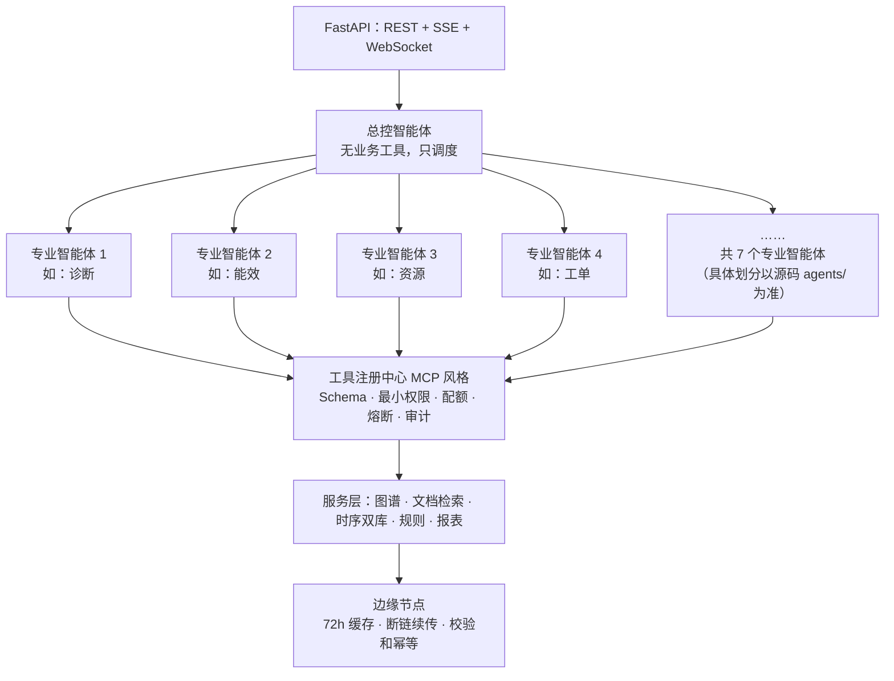

---
class: text-sm
---

# 五大技术点对照

| 技术点 | 实现 |
|---|---|
| **编排** | 状态机 + Checkpoint + 人工审批（`WaitingApproval`）；支持暂停 / 终止 / 恢复 / 回滚 |
| **工具** | 工具白名单、Schema 校验、最小权限、配额、熔断；总控无业务工具 |
| **记忆与状态** | `agent_tasks` 状态流转，`agent_checkpoints` 持久化 |
| **护栏** | 风险分级 L0-L4；L3 双人签批 + 作业票；RBAC + ABAC 风场隔离；WORM 哈希链审计 |
| **知识库** | 时态知识图谱 + GraphRAG 混合检索（向量 + BM25 → RRF → 重排），只取有效规程 |

---

# 知识工程与持续改进闭环

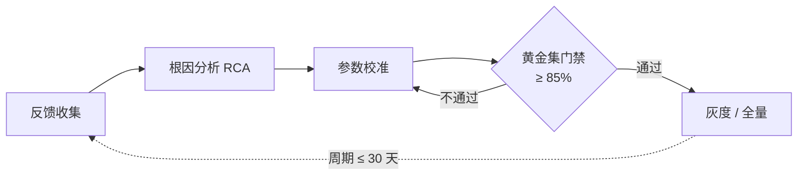

- 知识入库：LLM 抽取 + 五层校验 + 专家审核（涉及安全 / 新故障模式须专家）
- 审计：`audit_log` 哈希链 + 触发器禁止修改；规范指标达标表在"报表中心"

---

# 现场演示（按 DEMO.md）

```bash
python3 manage.py check    # 检查 PostgreSQL 与 DeepSeek 连通
python3 manage.py serve    # 启动，监听 :8000
```

| 步骤 | 账号 | 操作 |
|---|---|---|
| 1 | operator1 | 提问诊断，查看工具调用 |
| 2 | 系统 | 触发预警，生成紧急工单 |
| 3 | engineer1 | 执行工单 |
| 4 | approver1 / approver2 | L3 双人签批 |
| 5 | admin | 校验审计哈希链 |

<div class="text-sm opacity-80">演示账号密码仅用于开发，生产必须修改</div>

---

# 工程取舍（诚实说明）

| 设计文档选型 | 实际实现 |
|---|---|
| Neo4j / Milvus / TDengine / ES / Kafka / MinIO / Redis | 统一用 **PostgreSQL**（关系表 + 递归查询、哈希 n-gram 向量、双表时序） |
| bge-m3、私有化 Qwen | DeepSeek 云端 API；替换点 `embed` |
| LangGraph / Temporal / MCP / A2A / Keycloak / OPA | **自研等价最小实现**，接口已隔离，可平滑替换 |
| SCADA、EAM、AIS、气象 | 仿真器与种子数据 |

<div class="mt-3 p-2 bg-yellow-50 rounded text-sm">
该项目<b>未使用智能体框架</b>；这既是取舍，也是可替换性的设计示范
</div>

---
class: text-sm
---

# 两个案例对比（课堂填写）

| 维度 | TCMRxAgent | WindOnMAgent |
|---|---|---|
| 自主程度 | 辅助决策型 | 半自主 + 多智能体 |
| 核心风险 | 医疗误导 | 设备安全与生产事故 |
| 编排方式 | 规则规划为主，LLM 规划可选 | 总控 + 专业智能体、状态机 |
| 知识库 | RAG + 静态图谱（古籍 / 条文） | GraphRAG + 时态图谱（规程 / 台账 / 故障因果） |
| 记忆 | 会话 + 长期画像 | 任务状态 + 检查点 |
| 护栏重点 | 急症拦截、用药安全、输出核验 | 风险分级、双人审批、权限隔离、审计 |
| 人在回路 | 追问与免责声明 | 审批、作业票、低置信转人工 |

---
layout: section
---

# M10　案例巡礼、评测与上线

1 学时

---
class: text-sm
---

# 各类智能体案例巡礼（能源领域）

| 类型 | 典型场景 | 推荐技术 |
|---|---|---|
| 被动响应型 | 能源知识问答、设备数据查询、告警解释 | RAG、SQL 智能体、时序库、权限过滤、知识图谱 |
| 辅助决策型 | PHM 故障诊断、预测性维护方案、PEM / PQM 分析 | LangGraph、时序模型、故障树、知识图谱、人工确认 |
| 任务执行型 | PHM 工单、日报月报、质量异常闭环 | 工作流、CMMS API、审批流、审计日志 |
| 半自主型 | 风电 / 光伏健康监控、储能安全与寿命管理、检修资源协同 | 状态机、事件驱动、异常检测、数字孪生 |
| 全自主型 | 仿真策略评估、低风险辅助系统运维 | **仅限沙箱与可回滚系统**，数字孪生、安全约束 |
| 多智能体 | PHM 多智能体、电力交易与综合能源运营 | Supervisor、共享状态、合规审核智能体、审批网关 |

---

# 示例：电力交易多智能体协同

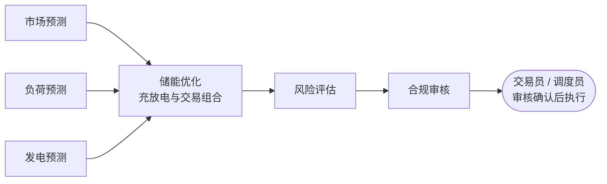

**风险边界**：不得未经授权与人工审批提交交易；数据缺失或置信度过低时不生成确定性指令；不得突破物理约束；不得以收益为由牺牲系统安全

---

# 通用应用：数据库与技术选型

| 维度 | 客服机器人 | 代码助手 | 多智能体系统 |
|---|---|---|---|
| 存储复杂度 | 低-中 | 中-高（符号关系、增量索引） | 高（任务图、消息总线） |
| 向量规模 | 万~十万 | 万~百万 | 中等，更关注记忆筛选 |
| 消息队列 | 可选 | 不太需要 | 建议引入 |
| 工作流引擎 | 不需要 | 不需要 | 复杂场景建议 |
| 多租户隔离 | 中等 | 非常重要 | 视产品形态 |
| 事务一致性 | 中 | 中 | 高 |

---

# 自主程度落地建议

<v-clicks>

- **被动响应型**：知识问答与查询，优先落地
- **辅助决策型**：高价值且风险可控的**主力形态**
- **任务执行型**：报表、工单、标准流程
- **半自主型**：持续监控与复杂流程，必须有阈值、审批、异常升级
- **全自主型**：仅用于仿真、离线优化、低风险系统
- **多智能体**：需统一权限、状态、通信与结果校验

</v-clicks>

---

# 评测

<v-clicks>

- 评测集必须**独立于开发者**，避免"自己出题自己答"
- 覆盖：带噪声、口语化、边界、攻击用例
- 指标：任务完成率、工具调用成功率、引用准确率、人工介入率、响应时长、Token 费用
- **回归基线 ≠ 真实准确率**
- 三类失败分别处理：规划失败、执行失败、质量失败

</v-clicks>

---

# 治理、部署与上线

| 方面 | 要求 |
|---|---|
| 权限 | 统一身份认证，RBAC / ABAC |
| 数据 | 分级分类、脱敏、加密 |
| 安全 | 工具白名单、提示注入防护、高风险操作审批 |
| 追溯 | 全链路日志与审计，模型输出带引用 |
| 运维 | 版本管理、回滚、应急停止 |
| 密钥 | `config.env` 不入库；生产**必须改默认密钥与演示账号** |
| 降级 | 外部模型不可用时回退本地模板 |
| 审校 | 专家审校后再面向真实用户 |

---

# 常见失败模式清单

| 失败模式 | 对应边界 / 监控 |
|---|---|
| 死循环 | 最大步数、超时 |
| 工具乱调 | 工具白名单、调用配额 |
| 幻觉引用 | 输出护栏核验引用 |
| 越权 | RBAC / ABAC、最小权限 |
| 知识过期 | 版本状态管理 |
| 上下文丢失 | 工作记忆 + 检查点 |
| 成本失控 | Token 预算、费用监控 |

---
layout: section
---

# M11　实操二：行业智能体工作坊

1.5 学时

---

# 工作坊：分组与时间

**4-5 人一组**：业务专家 · 架构设计 · 知识工程 · 开发（CodeBuddy）· 测试与护栏

| 时间 | 阶段 | 产出 |
|---|---|---|
| 20 min | ① 设计 | 《智能体设计卡》、架构图 |
| 55 min | ② 实现 | 在 M6 原型上扩展五项核心技术 |
| 15 min | ③ 测试 | 8 条测试问题，修复 1 个问题 |

---

# 实现要求

| 技术点 | 最低要求 |
|---|---|
| **任务编排** | 意图路由 + 子任务拆解，设步数上限 |
| **工具调用** | ≥ 3 个工具，含 1 个检索工具 |
| **RAG** | 行业文档入库，带引用输出 |
| **知识图谱** | ≥ 10 个实体、≥ 3 类关系，支持 1 个关系查询或鉴别问题 |
| **记忆** | 会话槽位 + 多轮追问 |
| **护栏** | 输入拒答 + 输出引用核验 + 高风险动作需确认 |

**测试 8 条**：4 条正常 · 2 条信息不足 · 2 条越界 / 攻击

---
class: text-sm
---

# 《智能体设计卡》

| 项目 | 内容 |
|---|---|
| 名称与定位 | |
| 用户对象 / 业务任务 | |
| 输入 / 输出 | |
| 自主程度与工作流模式 | |
| 任务编排（意图 → 工具链） | |
| 工具清单（名称 / 参数 / 读写 / 权限） | |
| 知识库（来源 / 形态 / 审校方式） | |
| RAG 策略（切块 / 嵌入 / 检索 / 重排） | |
| 知识图谱（实体 / 关系 / 用途） | |
| 记忆（工作 / 逐轮 / 长期；隐私措施） | |
| 护栏（输入 / 过程 / 输出；人在回路节点） | |
| 成功标准与评测方法 | |

---
layout: section
---

# M12　成果展示与总结

0.5 学时

---

# 展示与评分

**每组 3 分钟**：设计卡 + 1 个成功问答 + 1 个被护栏拦截的问答

| 维度 | 分值 | 评价要点 |
|---|---|---|
| 场景与边界清晰度 | 15 | 用户、任务、成功标准、红线明确 |
| 架构与编排合理性 | 20 | 模式选型合理，有步数 / 超时边界 |
| 知识库（RAG + 图谱） | 25 | 来源可信，带引用，图谱能答关系类问题 |
| 记忆与护栏 | 20 | 多轮不丢上下文，高风险动作有人工确认 |
| 可运行性与测试 | 10 | 能演示，有测试与失败记录 |
| 表达与反思 | 10 | 能说清局限与改进计划 |

---

# 要点回顾

<v-clicks>

1. 智能体 = LLM + 记忆 + 工具 + 规划 + 反馈循环；按自主程度分级
2. 高风险场景：**智能体辅助 + 规则约束 + 人工确认**
3. 工作流模式按任务特点选，**循环必有边界**
4. 开发流程：设计卡 → 知识工程 → 实现 → 评测 → 灰度 → 持续改进
5. 五项核心：**编排、工具、记忆、护栏、知识库（RAG + 图谱）**
6. RAG 找证据，图谱做推理，记忆保连续
7. 诚实交付：写清局限，评测要独立，专家要审校

</v-clicks>

---

# 考核与后续

| 项目 | 占比 |
|---|---|
| 课堂小测（M1、M2） | 20% |
| M6 最小原型 | 20% |
| M11 小组智能体与设计卡 | 40% |
| 展示与互评 | 20% |

**结业产出**：设计卡 · 可运行原型 · 测试记录 · 一页"局限与改进计划"

**后续学习**：读懂两个案例的源码 · 把原型接入真实业务数据（脱敏）· 建立独立评测集

---
layout: center
class: text-center
---

# 谢谢

欢迎提问与交流

<div class="mt-8 text-sm opacity-60">
参考：bettermorn/AIAgent 仓库 docs/ 与 code/IndustryAgent/
</div>
