# AI Agent的类型

根据自主程度分为以下类型。

| 类型 | 工作方式 | 适用场景 | 主要特点 |
|---|---|---|---|
| 被动响应型 Agent | 接收用户明确指令后执行单次任务，不主动规划，也不会持续跟踪任务状态 | 问答、信息检索、文本生成、简单数据查询、客服 FAQ | 自主程度最低；响应速度快；行为可控；通常不具备长期记忆和连续执行能力 |
| 辅助决策型 Agent（Copilot） | 在用户主导下提供建议、草稿、分析结果或操作辅助，由用户确认后完成最终决策和执行 | 编程辅助、文档撰写、销售支持、数据分析、办公自动化 | 人机协作；用户拥有最终控制权；能够理解上下文并提供个性化建议；适合高风险或需要人工审核的任务 |
| 任务执行型 Agent | 用户给出目标后，Agent 会自行拆解任务、调用工具并执行多个步骤，但通常需要关键节点确认 | 自动生成报表、数据清洗、部署应用、处理工单、执行标准业务流程 | 具备一定规划和工具调用能力；可连续执行任务；在关键操作前通常需要人工审批；兼顾效率与可控性 |
| 半自主型 Agent | 仅需接收较高层次的目标，能够自主规划、执行、监控和调整任务，遇到异常或高风险情况时请求人工介入 | 复杂数据工程、自动化运维、研究分析、供应链管理、营销活动编排 | 自主程度较高；具备状态跟踪、错误恢复和动态调整能力；采用“人在回路中”机制；适合流程较复杂但仍需监督的任务 |
| 全自主型 Agent | 根据目标或约束条件独立完成任务，包括规划、决策、工具调用、执行、评估和迭代，通常无需人工逐步干预 | 长时间运行的监控系统、自动化交易模拟、虚拟企业运营、复杂科研探索、无人化流程 | 自主程度最高；能够持续运行和自我调整；对环境感知、记忆、规划和安全控制要求高；存在误操作、目标偏离和合规风险 |
| 多 Agent 协作系统 | 多个具有不同职责的 Agent 分工协作，由协调 Agent 或通信机制分配任务、汇总结果和处理冲突 | 软件研发团队模拟、复杂研究项目、端到端业务流程、跨部门自动化 | 通过角色分工提升复杂任务处理能力；可并行执行；系统设计和协作成本较高；需要统一权限、通信和结果校验机制 |


AI Agent 的自主程度通常从低到高依次为：
被动响应型 → 辅助决策型 → 任务执行型 → 半自主型 → 全自主型。
其中，多 Agent 协作系统不完全是单独的自主等级，而是一种系统组织方式，可以分别构建为辅助型、半自主型或全自主型系统。


# 判断一个任务是否适合使用 Agent

主要看以下几个方面：
- 是否需要理解自然语言和用户意图；
- 是否需要调用多个工具或系统；
- 是否需要根据条件进行动态决策；
- 是否需要多步骤执行；
- 是否允许出现错误，是否涉及高风险操作；
- 是否需要人工确认或审批。

|任务|	是否适合使用 Agent|	更合适的实现方式|
|----|--|--|
|查询员工报销制度|	部分适合	|知识库问答或轻量 Agent|
|自动查询天气并安排出行|	适合	|多工具协同 Agent|
|分析销售数据并生成报告	|适合|	数据分析 Agent|
|自动审批所有财务申请|	不适合完全自动化|	规则引擎 + Agent 辅助 + 人工审批|
|根据客户需求推荐产品|	适合	|推荐型 Agent|

1. 适合直接使用 Agent 的任务
- 自动查询天气并安排出行；
- 分析销售数据并生成报告；
- 根据客户需求推荐产品。
这些任务都需要信息理解、工具调用、多步骤处理和动态决策。
2. 适合使用轻量 Agent 或知识库系统的任务
- 查询员工报销制度。
如果只是查制度，知识库问答就足够；如果还需要结合员工身份、费用、地区和审批流程进行判断，则可以升级为 Agent。
3. 不适合完全自动化，但适合 Agent 辅助的任务
- 自动审批所有财务申请。
- Agent 可以负责资料检查、规则匹配、风险识别和审批建议，但涉及资金、合规和责任的最终决策，应保留人工审批和审计机制。
总体上，Agent 最适合“需要理解、判断、调用工具并完成多个步骤”的任务；对于高风险、高责任的决策，应采用“Agent 辅助 + 规则约束 + 人工确认”的模式。

# AI Agent的基本结构
- 用户输入；
- 所需知识；
- 可用工具；
- Agent 决策步骤；
- 最终输出。

出差助手 Agent 模块	主要内容

- 用户输入：	出差人员、地点、时间、事由、交通、费用、项目等
- 所需知识：	差旅制度、审批规则、组织架构、预算规则、日期规则、合规要求
- 可用工具：	员工查询、政策查询、预算计算、项目校验、申请创建、审批提交、状态查询、通知工具
- Agent决策步骤：	理解意图 → 提取信息 → 补齐字段 → 查政策 → 算预算 → 做合规检查 → 生成草稿 → 用户确认 → 创建并提交
- 最终输出：	政策说明、预算结果、申请草稿、风险提醒、申请单号、审批状态

# 常见Agent工作流模式
## 1. 基础 Agent 工作流：感知—思考—行动

这是最基础的 Agent 循环，适合说明 Agent 如何接收任务、进行推理、调用工具并返回结果。

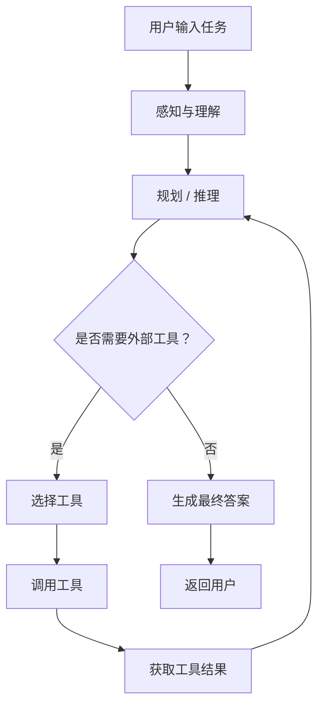

### 特点

- 结构简单，适合单轮或多轮任务。
- Agent 可以根据中间结果决定是否调用工具。
- 工具结果会反馈给推理模块，形成循环。
- 缺点是规划、执行、校验通常混在一起，复杂任务中可控性较弱。

---

## 2. ReAct 模式：推理与行动交替

ReAct，即 Reasoning + Acting，是最经典的 Agent 模式之一。Agent 在每一轮中交替进行思考、行动和观察。

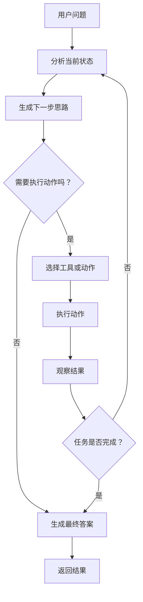

### 典型循环

```text
Thought → Action → Observation → Thought → Action → ...
```

### 适用场景

- 搜索问答
- 数据库查询
- 浏览器操作
- API 调用
- 需要根据工具返回结果动态决策的任务

### 优点与缺点

优点：

- 灵活性高。
- 可以根据实时结果动态调整策略。
- 适合开放式任务。

缺点：

- 容易出现无限循环。
- 推理过程可能不稳定。
- 工具调用次数和成本较难控制。
- 需要设置最大步数、超时和异常处理。

---

## 3. Plan-and-Execute：先规划，后执行

Plan-and-Execute 模式将“任务分解”和“具体执行”分离。适用于复杂、多步骤、目标明确的任务。

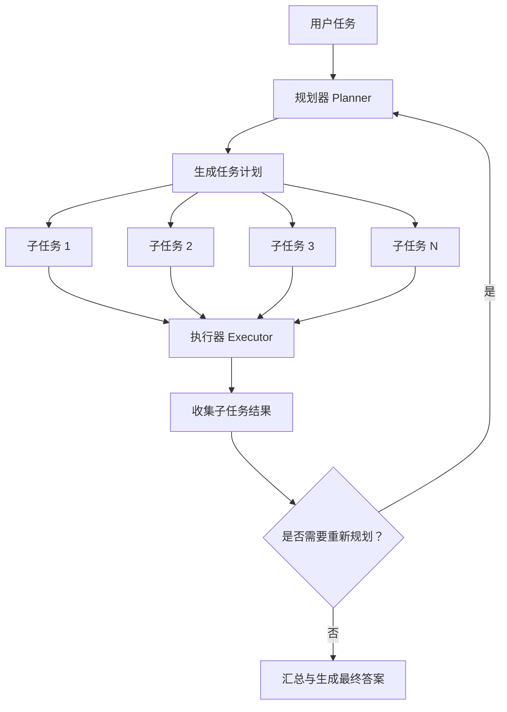

### 常见变体

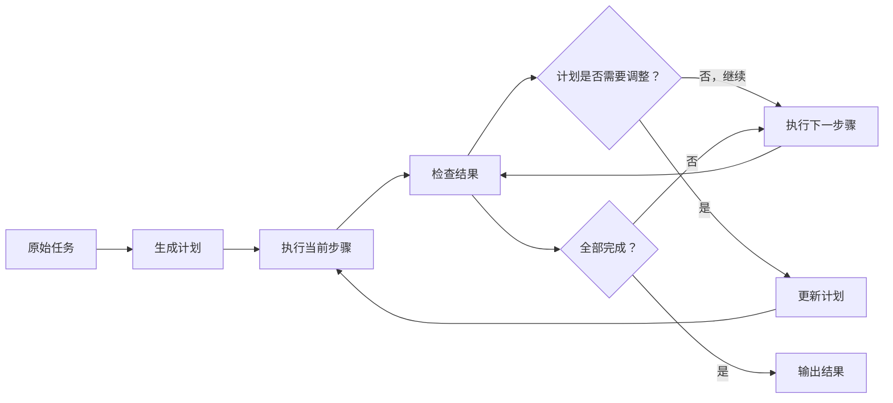

### 适用场景

- 研究报告生成
- 软件项目任务拆解
- 复杂数据分析
- 多步骤自动化
- 需要明确展示执行计划的任务

### 优点

- 任务结构清晰。
- 便于监控每个步骤。
- 支持失败重试和局部恢复。
- 便于人工审核计划。

### 缺点

- 初始计划可能不准确。
- 如果环境变化较大，需要动态重规划。
- 简单任务使用该模式可能增加不必要的开销。

---

## 4. Router 模式：任务路由到专用 Agent

Router 模式由一个路由器判断用户意图，并将任务分发给不同的专家 Agent 或处理链。

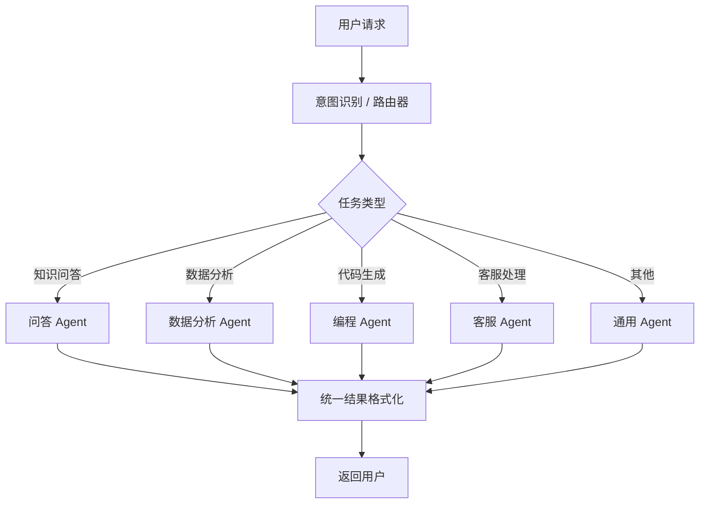

### 带置信度和人工兜底的 Router

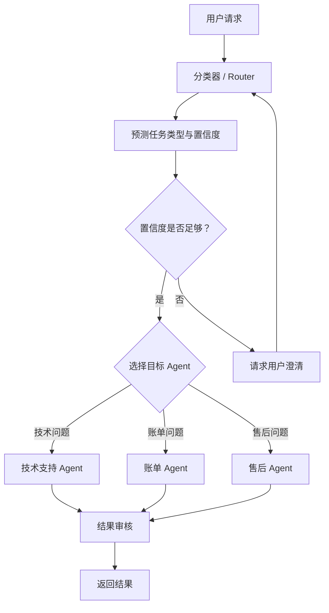

### 适用场景

- 企业客服
- 多领域知识问答
- 多业务系统入口
- 多 Agent 平台
- 不同任务需要不同提示词、工具和权限的场景

---

## 5. 并行 Agent 模式：多个 Agent 同时处理

当一个任务可以拆成互相独立的子任务时，可以让多个 Agent 并行执行，从而减少整体耗时。

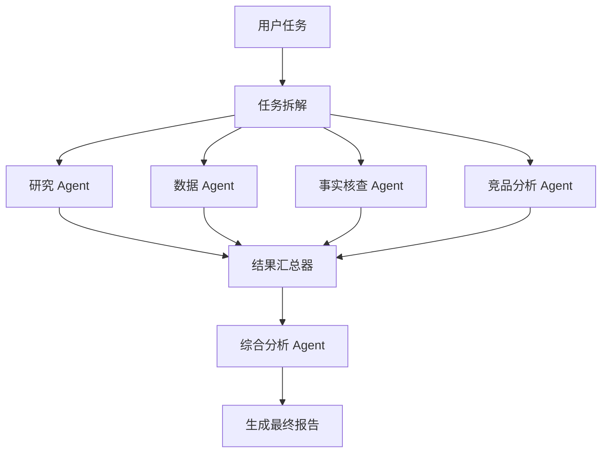

### 带失败处理的并行模式

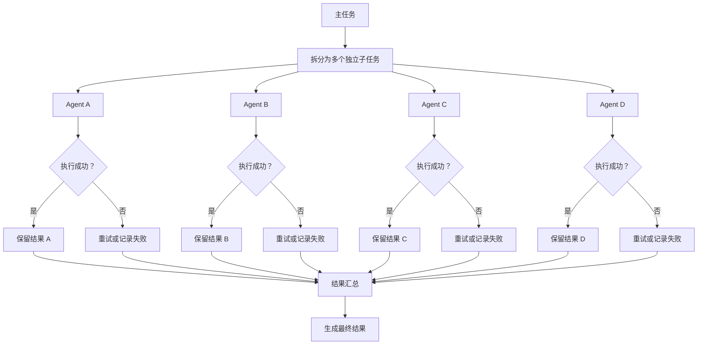

### 适用场景

- 多来源资料搜集
- 多维度分析
- 批量文档处理
- 多个独立 API 查询
- 多模型交叉判断

### 注意事项

- 子任务之间必须尽量独立。
- 需要处理超时、部分失败和重复执行。
- 汇总器需要解决结果冲突问题。
- 并行执行会增加资源消耗和调用成本。

---

## 6. Reflection / Self-Correction：生成—评审—修正

Reflection 模式让一个 Agent 或多个 Agent 对初始结果进行评审，并根据反馈持续改进。

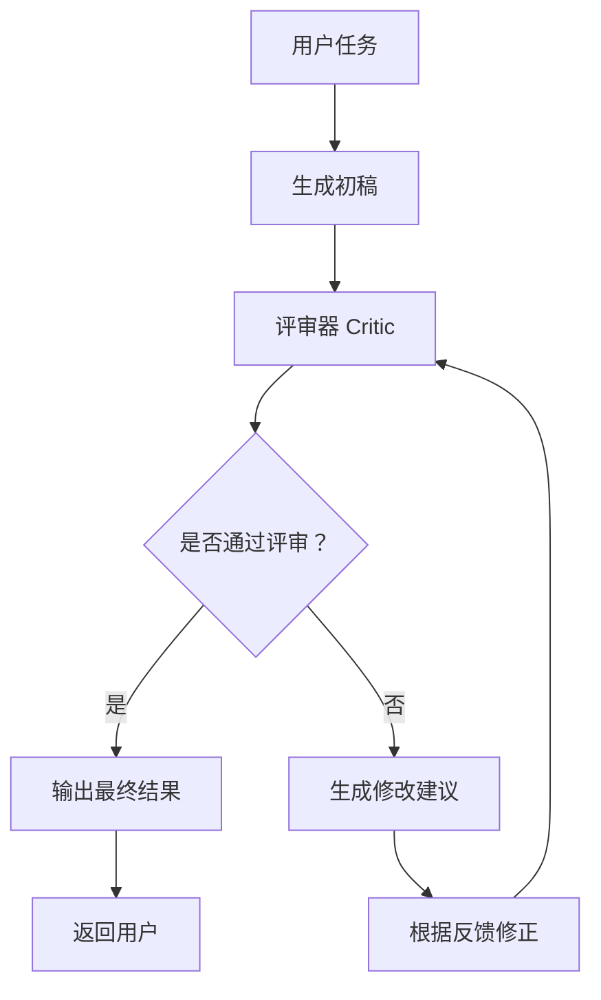

### 双 Agent 评审模式

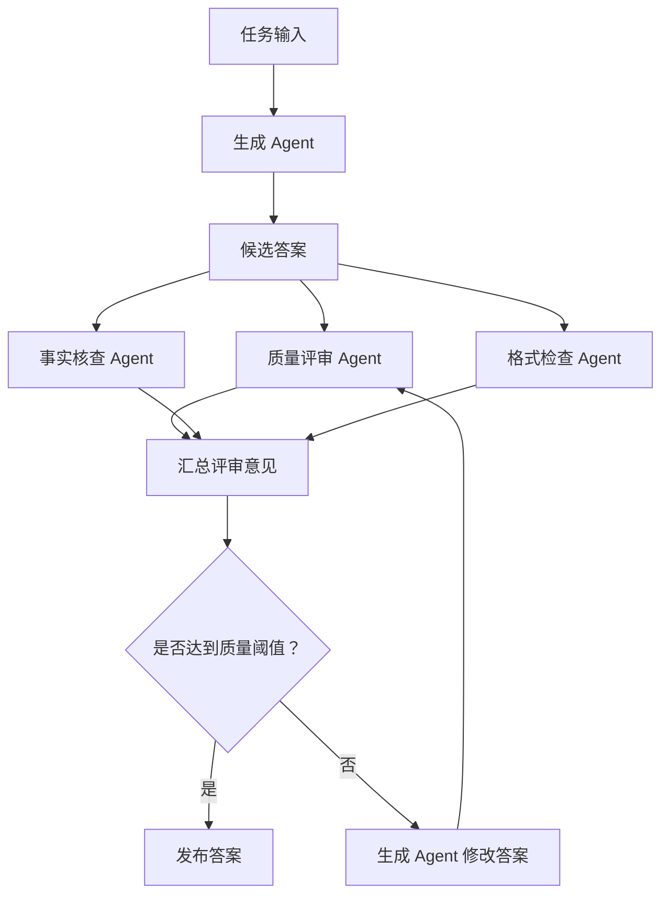

### 适用场景

- 长文写作
- 代码生成与修复
- 结构化报告
- 法律、医疗、金融等高风险内容
- 需要提高准确率和格式一致性的场景

### 常见评审指标

- 事实正确性
- 任务完成度
- 逻辑一致性
- 格式规范
- 安全性
- 引用完整性
- 是否包含幻觉内容

---

## 7. Supervisor 多 Agent 协作模式

Supervisor 模式由一个主管 Agent 负责拆分任务、分配工作、收集结果和协调多个专家 Agent。

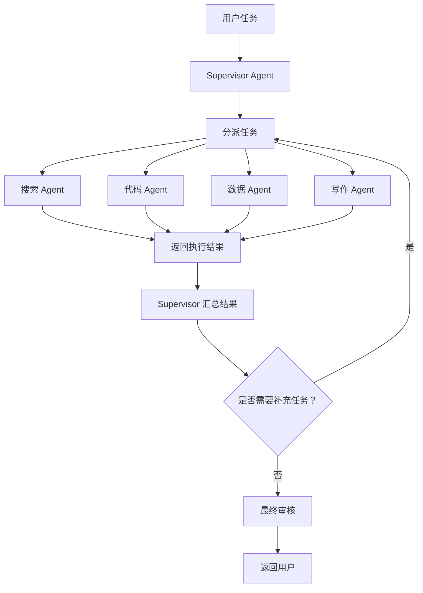

### Supervisor 负责的内容

- 任务拆解
- Agent 选择
- 参数传递
- 上下文管理
- 结果合并
- 冲突解决
- 失败重试
- 最终决策

### 适用场景

- 多角色协作
- 软件开发 Agent 团队
- 复杂研究工作流
- 需要动态调度多个工具和专家的任务

### 与 Router 的区别

| 模式 | 核心逻辑 |
|---|---|
| Router | 通常选择一个最合适的处理 Agent |
| Supervisor | 可以连续调度多个 Agent，并根据中间结果动态决策 |

---

## 8. Human-in-the-Loop：人工审批工作流

在高风险或不可逆操作前暂停流程，请求人工确认。

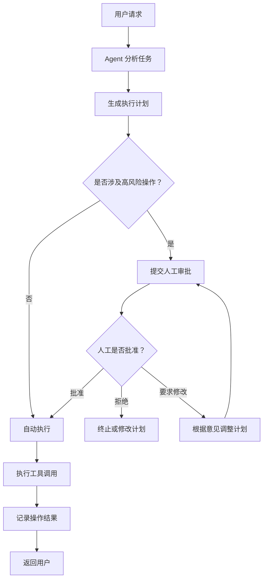

### 典型需要人工审批的操作

- 删除数据
- 发送邮件或消息
- 发布文章
- 执行支付
- 修改生产环境
- 提交法律或财务文件
- 对外发布敏感结论
- 访问高权限系统

### 推荐设计

人工审批节点应清楚展示：

- Agent 准备执行什么操作
- 使用了哪些参数
- 可能产生什么影响
- 是否可以撤销
- 审批人是谁
- 审批超时时如何处理

---

## 9. RAG Agent：检索增强生成

RAG Agent 会先判断是否需要检索知识库，然后进行查询、重排、生成答案和引用校验。

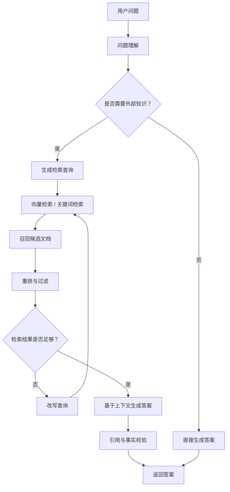

### RAG Agent 中常见的工具

- 向量数据库
- 全文搜索引擎
- 文档解析器
- 重排序模型
- 知识图谱
- SQL 查询工具
- 网页搜索工具

---

## 10. 工具调用与异常恢复模式

实际 Agent 通常需要处理工具调用失败、超时、参数错误和权限问题。

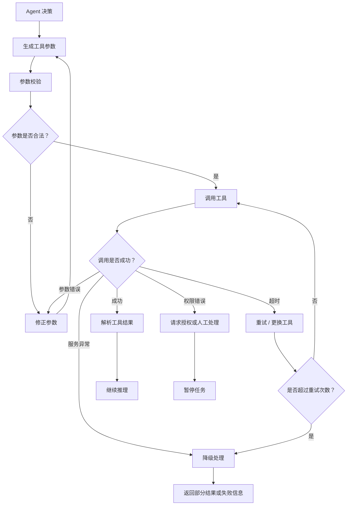

### 生产环境中建议设置

- 最大推理步数
- 最大工具调用次数
- 单次调用超时时间
- 总体任务超时时间
- 最大重试次数
- 指数退避
- 幂等键
- 工具调用审计日志
- 失败降级策略
- 敏感参数脱敏

---

# 综合型 Agent 工作流示例

下面是一个将路由、规划、并行执行、工具调用、评审和人工审批结合起来的综合流程。

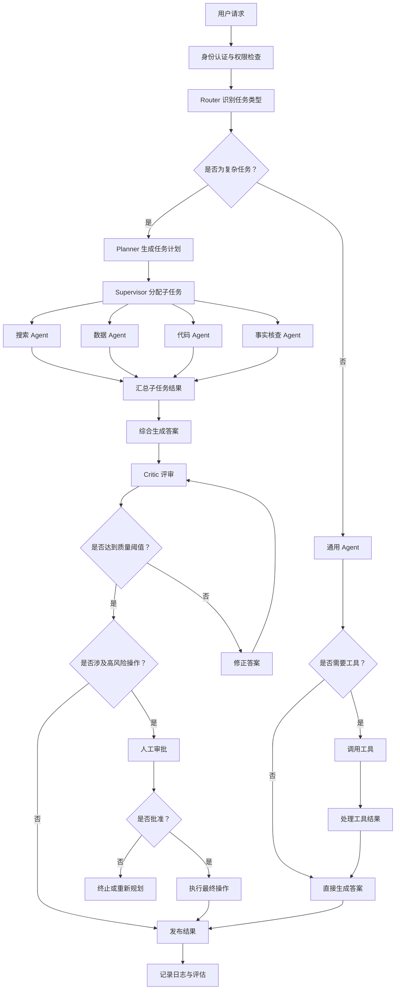

---

# 常见 Agent 工作流模式对比

| 模式 | 核心特点 | 适合场景 |
|---|---|---|
| 基础 Agent 循环 | 感知、推理、行动循环 | 简单工具调用 |
| ReAct | 推理与行动交替 | 搜索、浏览器、动态决策 |
| Plan-and-Execute | 先规划再执行 | 复杂多步骤任务 |
| Router | 按任务类型分发 | 多领域、多业务入口 |
| 并行 Agent | 多个 Agent 同时工作 | 独立子任务、批处理 |
| Reflection | 生成后自我评审和修正 | 写作、代码、报告 |
| Supervisor | 主管调度多个专家 | 多 Agent 协作 |
| Human-in-the-Loop | 关键节点人工确认 | 高风险、不可逆操作 |
| RAG Agent | 检索外部知识后生成 | 企业知识库、文档问答 |
| 异常恢复 | 重试、降级、人工介入 | 生产级工具调用 |

---

# 设计 Agent 工作流时的通用建议

1. **简单任务优先使用简单流程**  
   不要为了使用多 Agent 而引入复杂架构。

2. **明确状态和上下文**  
   每一步最好记录：
   - 当前任务状态
   - 已完成步骤
   - 工具调用结果
   - 错误信息
   - 剩余预算和时间

3. **为循环设置边界**

   ```text
   最大步数
   最大重试次数
   最大工具调用次数
   最大 Token 消耗
   最大执行时间
   ```

4. **工具调用必须可审计**  
   记录工具名称、参数、返回值摘要、调用者和时间。

5. **高风险操作增加人工审批**  
   尤其是支付、删除、发布、生产环境变更等操作。

6. **支持部分失败**  
   并行任务中不应因为一个子任务失败就导致全部结果丢失。

7. **区分规划失败和执行失败**
   - 规划失败：重新拆解任务。
   - 执行失败：重试、替换工具或降级。
   - 结果质量失败：进入 Reflection 流程。

8. **加入可观测性**
   建议监控：
   - 平均任务耗时
   - Agent 步数
   - 工具调用成功率
   - 重试率
   - 人工介入率
   - 最终任务完成率
   - Token 和费用消耗

9. **统一输出格式**
   多 Agent 协作时，建议使用结构化结果，例如：

   ```json
   {
     "status": "success",
     "summary": "任务摘要",
     "evidence": [],
     "warnings": [],
     "next_action": null
   }
   ```

10. **将不可控的自由推理转换为可控状态机**
    对生产系统而言，通常推荐：

    ```text
    状态定义
    → 节点定义
    → 转移条件
    → 工具权限
    → 超时与重试
    → 审批节点
    → 结果校验
    ```

# AI Agent 不同工作流的技术方案

## 1 10 种工作流与技术方案总表

| # | 工作流 | 核心技术方案 | 关键风险控制 |
|---|---|---|---|
| 1 | 基础 Agent 循环（感知—思考—行动） | LLM + 工具调用（Function Calling）+ 循环 | 规划、执行、校验混在一起，需额外约束 |
| 2 | ReAct | LLM 推理 + 工具调用 + 观察反馈循环 | 最大步数、超时、异常处理 |
| 3 | Plan-and-Execute | Planner（规划器）+ Executor（执行器）+ 重规划 | 初始计划不准，需重规划机制 |
| 4 | Router | 意图识别/分类器 + 多个专用 Agent + 置信度判断 | 低置信度时请求澄清 |
| 5 | 并行 Agent | 任务拆解 + 并发执行 + 结果汇总器 | 超时、部分失败、结果冲突 |
| 6 | Reflection / Self-Correction | 生成 Agent + 评审 Agent（Critic）+ 质量阈值 | 评审指标要明确，防止无限修订 |
| 7 | Supervisor 多 Agent | 主管 Agent + 专家 Agent + 上下文管理 | 权限、通信、结果校验 |
| 8 | Human-in-the-Loop | 流程暂停点 + 审批界面 + 状态持久化 | 审批超时处理、可撤销性 |
| 9 | RAG Agent | 向量检索 + 关键词检索 + 重排 + 引用校验 | 检索不足时改写查询 |
| 10 | 工具调用与异常恢复 | 参数校验 + 重试 + 降级 + 审计日志 | 幂等、脱敏、权限 |

### 1.1 工作流 × 具体框架对照表

| # | 工作流 | 首选框架 | 备选框架 | 仓库中实际使用的项目（已扫描） |
|---|---|---|---|---|
| 1 | 基础循环 | **OpenAI Agents SDK**（`Agent` + `Runner`）【补充·已核实】；或直接用模型厂商的 Function Calling API | LangChain【补充·未核实具体接口】 | AgentSkills、EnglishStudyAssistant、LegalAssistant 等只依赖 `openai` 包（直接调模型 API），是否为工具循环**未逐个核实** |
| 2 | ReAct | **LangGraph**（预置的 ReAct 式 Agent）【补充·已核实 LangGraph 本身】 | OpenAI Agents SDK；Google ADK 的 LLM Agent【补充·已核实】 | 仓库内**未扫描到**使用 `create_react_agent` 的项目 |
| 3 | Plan-and-Execute | **LangGraph**（Planner 节点 + Executor 节点 + 条件边做重规划）【补充·已核实】 | Microsoft Agent Framework 的 workflows（基于图）【补充·已核实】 | SuperAgent（`orchestrator_langgraph.py`，LangGraph 状态图；是否严格为 Plan-and-Execute **未核实**） |
| 4 | Router | **LangGraph**（`add_conditional_edges` 条件边）【补充·已核实】 | OpenAI Agents SDK 的 handoffs（triage Agent 转交）；Google ADK 的 `transfer_to_agent`【补充·已核实】 | GameNPC（`game_npc_langgraph/main.py`，用了 `StateGraph` + 条件边） |
| 5 | 并行 Agent | **LangGraph**（并行分支 / `Send` API）；Google ADK 的 `ParallelAgent`【补充·已核实】 | Python `asyncio.gather` 自己写；OpenAI Agents SDK 无原生并行，需自行编排【补充·已核实】 | 仓库内**未扫描到**专门的并行 Agent 实现 |
| 6 | Reflection | **LangGraph**（生成节点 ↔ 评审节点循环，`recursion_limit` 限制轮数）【补充·已核实】 | Google ADK 的 `LoopAgent`【补充·已核实】；Microsoft Agent Framework | EssayWriter（`backend/essay_graph.py`、`Lesson_6_Student.py`：`StateGraph` + 条件边；是否为"生成—评审"结构**未逐行核实**） |
| 7 | Supervisor | **LangGraph**（supervisor / swarm / hierarchical 三种拓扑）【补充·已核实】 | Microsoft Agent Framework；OpenAI Agents SDK（agents as tools / handoffs）；Google ADK（`sub_agents`）；CrewAI【补充·未核实】 | SuperAgent（LangGraph） |
| 8 | Human-in-the-Loop | **LangGraph**（`interrupt()` + `Command(resume=...)`，旧写法 `interrupt_before`；检查点用 `PostgresSaver`）【补充·已核实】 | OpenAI Agents SDK 的可恢复审批流（resumable approval）【补充·已核实】 | HumanIntheLoop（`Lesson_5_Student.py`：`StateGraph` + `SqliteSaver` + `interrupt_before`） |
| 9 | RAG Agent | **LangChain** 检索组件 + 向量库（Pinecone / FAISS 等） | LlamaIndex【补充·未核实】；Chroma、Milvus、pgvector、Elasticsearch 做向量/全文库【补充·未核实】 | RAG_CustomerService_KQA（`langchain-pinecone` 的 `PineconeVectorStore`）；HealthAssistant（`faiss-cpu` + `sentence-transformers`）；LegalAssistant（FAISS）；WindOnMAgent（自写 BM25 和嵌入服务，**无** Agent 框架） |
| 10 | 工具调用与异常恢复 | **MCP**（工具接入标准）【补充·已核实】；重试/退避可用 `tenacity` 一类库【补充·未核实】 | LangSmith（审计与观测）；OpenAI Agents SDK 内置 tracing 与 guardrails【补充·已核实】 | MCPSevClient（`FastMCP` 服务端 + `ClientSession` 客户端，依赖 `mcp>=1.2.0,<2`） |
| — | 跨 Agent 通信 | **A2A 协议** + `a2a-sdk`【补充·已核实】 | — | A2A_Agent（`a2a-sdk==0.3.8`） |


## 2 逐个工作流的技术方案

### 2.1. 基础 Agent 工作流：感知—思考—行动

**流程**：用户输入 → 感知理解 → 规划/推理 → 是否需要工具 → 调用工具 → 结果回到推理 → 返回答案

| 层面 | 技术方案 |
|---|---|
| 模型 | 【补充】支持 Function Calling 的大模型（仓库统一使用 DeepSeek） |
| 工具 | 【原文】选择工具 → 调用工具 → 获取结果的循环；【补充】用 JSON Schema 描述工具参数 |
| 控制 | 【原文】规划、执行、校验混在一起，复杂任务可控性较弱，因此只适合简单任务 |
| **框架** | 【补充·已核实】OpenAI Agents SDK：`Agent`（模型+指令+工具）+ `Runner.run()` 即由 SDK 跑工具循环，自带 tracing 和 guardrails。<br>【补充】不想引入框架时，直接用模型的 Function Calling 接口自己写循环（仓库多个项目只依赖 `openai` 包） |

**适合**：单轮或多轮的简单工具调用。


### 2.2. ReAct：推理与行动交替

**循环**：`Thought → Action → Observation → Thought → Action → …`

| 层面 | 技术方案 |
|---|---|
| 推理 | 【补充】提示词中要求模型输出 Thought/Action 格式，或使用原生工具调用 |
| 动作 | 【原文】搜索、数据库查询、浏览器操作、API 调用 |
| 循环保护 | 【原文】必须设置**最大步数、超时、异常处理**（文章指出 ReAct 容易无限循环、成本难控） |
| 成本控制 | 【原文】工具调用次数和成本较难控制，需限制调用次数 |
| **框架** | 【补充·已核实】LangGraph 以 `recursion_limit` 限制图的循环步数，防止 ReAct 无限循环；LangSmith 可看逐节点执行和 Token 用量。<br>备选：OpenAI Agents SDK、Google ADK 的 LLM Agent（均为模型 + 工具 + 循环） |

**适合**：开放式任务、需要根据工具返回结果动态决策的任务。
**不适合**：需要稳定、可审计流程的任务。


### 2.3. Plan-and-Execute：先规划，后执行

| 组件 | 技术方案 |
|---|---|
| Planner | 【原文】规划器，生成任务计划；【补充】让 LLM 输出结构化步骤列表（JSON） |
| Executor | 【原文】执行器，逐个执行子任务；【补充】每个子任务可内部用 ReAct |
| 重规划 | 【原文】"检查结果 → 计划是否需要调整 → 更新计划"的循环 |
| 状态 | 【补充】保存计划、已完成步骤、中间结果（状态图或数据库） |
| 人工审核 | 【原文】便于人工审核计划，在计划生成后设审批点 |
| **框架** | 【补充·已核实】LangGraph：Planner、Executor、Replanner 各为一个节点，用条件边决定"继续执行 / 重规划 / 结束"，计划和已完成步骤放在图状态里，配检查点可做断点恢复。<br>备选：Microsoft Agent Framework 的 workflows（基于图的编排） |

**优点**：结构清晰、易监控、支持失败重试和局部恢复。
**注意**：简单任务用它会增加不必要的开销。


### 2.4. Router：任务路由到专用 Agent

| 组件 | 技术方案 |
|---|---|
| 意图识别 | 【原文】分类器/路由器预测任务类型与**置信度**；【补充】可用 LLM 分类、小模型分类或规则 + 关键词 |
| 低置信度处理 | 【原文】置信度不足时**请求用户澄清**，再重新路由 |
| 专用 Agent | 【原文】不同任务需要不同提示词、工具和权限；【补充】每个 Agent 独立配置工具白名单 |
| 结果处理 | 【原文】统一结果格式化，必要时加结果审核 |
| **框架** | 【补充·已核实】LangGraph：路由节点输出类别和置信度，`add_conditional_edges` 按类别跳转到不同 Agent 子图；低置信度跳到"澄清"节点。<br>OpenAI Agents SDK：triage Agent 通过 `handoffs=[...]` 把任务转交给专用 Agent。<br>Google ADK：`transfer_to_agent`；注意避免把路由 Agent 自己列为转交目标，否则会递归【补充·已核实（来自第三方使用记录）】 |

**与 Supervisor 的区别**【原文】：Router 通常只选**一个**最合适的 Agent；Supervisor 可连续调度多个 Agent，并根据中间结果动态决策。


### 2.5. 并行 Agent：多个 Agent 同时处理

| 组件 | 技术方案 |
|---|---|
| 任务拆解 | 【原文】拆成**互相独立**的子任务 |
| 并发执行 | 【补充】异步并发（如 `asyncio.gather` / `Promise.all`）或图的并行分支 |
| 失败处理 | 【原文】每个子任务单独判断成功/失败，失败则重试或记录，**不能因一个失败丢掉全部结果** |
| 汇总 | 【原文】结果汇总器 + 综合分析 Agent，需解决**结果冲突** |
| **框架** | 【补充·已核实】LangGraph 的并行分支或 `Send` API（动态扇出）；Google ADK 的 `ParallelAgent`（扇出、错误隔离、结果聚合）。<br>OpenAI Agents SDK 没有原生并行模式，需要自己用 `asyncio.gather` 编排（第三方使用记录）<br>【补充】多个写同一状态键的并行 Agent 要用不同的键，否则会互相覆盖（第三方文章报告过 OpenAI SDK 上下文变量被静默覆盖的情况） |

**代价**【原文】：资源消耗和调用成本增加。


### 2.6. Reflection / Self-Correction：生成—评审—修正

| 组件 | 技术方案 |
|---|---|
| 生成 | 【原文】生成 Agent 产出初稿 |
| 评审 | 【原文】Critic，可拆成质量评审、事实核查、格式检查多个 Agent |
| 评审指标 | 【原文】事实正确性、任务完成度、逻辑一致性、格式规范、安全性、引用完整性、是否有幻觉 |
| 终止条件 | 【原文】达到**质量阈值**才发布；【补充】同时设最大修订轮数，避免死循环 |
| **框架** | 【补充·已核实】LangGraph：生成节点 → 评审节点 → 条件边（达标发布 / 不达标回到生成），`recursion_limit` 兜底。<br>Google ADK：`LoopAgent` 做迭代修订。<br>OpenAI Agents SDK 的 guardrails 可做输出检查，但它是"拦截"，不是"修订循环" |

**适合**：长文写作、代码生成与修复、结构化报告、法律/医疗/金融等高风险内容。


### 2.7. Supervisor 多 Agent 协作

| 组件 | 技术方案 |
|---|---|
| 主管职责 | 【原文】任务拆解、Agent 选择、参数传递、上下文管理、结果合并、冲突解决、失败重试、最终决策 |
| 专家 Agent | 【原文】搜索、代码、数据、写作等角色 |
| 动态调度 | 【原文】根据中间结果判断是否需要补充任务，形成循环 |
| 通信与权限 | 【补充】统一消息格式、各 Agent 最小权限；可考虑 A2A 等跨 Agent 协议 |
| 最终审核 | 【原文】Supervisor 汇总后做最终审核再返回 |
| **框架** | 【补充·已核实】LangGraph 支持 supervisor、swarm、hierarchical 三种多 Agent 拓扑，其中 supervisor 是其原生模式。<br>Microsoft Agent Framework（AutoGen 与 Semantic Kernel 的继任者，已发布 1.0，支持 A2A 与 MCP）。<br>OpenAI Agents SDK：agents-as-tools 或 handoffs。Google ADK：`sub_agents` 层级。<br>**注意**：Microsoft **AutoGen 已归档、不再维护**，新项目不建议选用。<br>【补充·未核实】CrewAI 也常用于角色式多 Agent 协作，我没有查证其当前状态 |


### 2.8. Human-in-the-Loop：人工审批

| 组件 | 技术方案 |
|---|---|
| 风险判断 | 【原文】识别高风险操作：删除数据、发邮件/消息、发布文章、支付、改生产环境、提交法律财务文件、访问高权限系统 |
| 暂停与恢复 | 【补充】流程在审批节点**暂停并持久化状态**，批准后从断点继续（检查点机制，如数据库存储） |
| 审批界面 | 【原文】应展示：将执行什么操作、使用什么参数、可能的影响、能否撤销、审批人是谁、超时如何处理 |
| 三种审批结果 | 【原文】批准 → 执行；拒绝 → 终止或修改；要求修改 → 调整计划后重新审批 |
| 审计 | 【原文】记录操作结果 |
| **框架** | 【补充·已核实】LangGraph：`interrupt()` 暂停，审批后用 `Command(resume=...)` 恢复（旧写法 `interrupt_before`）；`graph.update_state()` 可改状态。检查点：`MemorySaver` **只适合单进程**调试，生产用 `PostgresSaver` / `AsyncPostgresSaver`，仓库示例用 `SqliteSaver`（`langgraph-checkpoint-sqlite`）。<br>OpenAI Agents SDK：可恢复的审批流（run 暂停等待批准）。<br>**版本提示**：仓库 HumanIntheLoop 固定 `langgraph>=0.2,<0.4`，用的是旧写法；新版本的 `interrupt()` 需要自行迁移 |


### 2.9. RAG Agent：检索增强生成

**流程**：判断是否需要外部知识 → 生成检索查询 → 检索 → 重排过滤 → 结果不足则改写查询 → 基于上下文生成 → **引用与事实校验**

| 环节 | 技术方案 |
|---|---|
| 检索 | 【原文】向量检索 / 关键词检索；【补充】两者可混合（如向量 + BM25） |
| 常见工具 | 【原文】向量数据库、全文搜索引擎、文档解析器、重排序模型、知识图谱、SQL 查询工具、网页搜索工具 |
| 查询改写 | 【原文】检索不足时改写查询后重新检索 |
| 生成后校验 | 【原文】引用与事实校验，降低幻觉 |
| **框架与组件** | 【仓库】LangChain + `langchain-pinecone`（`PineconeVectorStore`，托管向量库，RAG_CustomerService_KQA）；`faiss-cpu` + `sentence-transformers`（本地向量检索，HealthAssistant）；FAISS（LegalAssistant）；WindOnMAgent 不用框架，自写 BM25 + 嵌入 + 重排服务。<br>【补充·未核实】可选：LlamaIndex（数据接入和检索框架）；Chroma、Milvus、pgvector、Elasticsearch（向量 / 全文库）；Neo4j（图谱）。这些我未查证当前版本和能力 |

**与"知识库问答"的区别**【原文】：只查制度，知识库问答就够；若还要结合身份、费用、地区、审批流程做判断，才升级为 Agent。


###2.10. 工具调用与异常恢复

**异常分类处理**【原文】

| 情况 | 处理 |
|---|---|
| 参数不合法 / 参数错误 | 修正参数后重新调用 |
| 超时 | 重试或更换工具，超过次数后降级 |
| 权限错误 | 请求授权或人工处理，暂停任务 |
| 服务异常 | 降级，返回部分结果或失败信息 |

**生产环境建议设置**【原文】：最大推理步数、最大工具调用次数、单次调用超时、总任务超时、最大重试次数、**指数退避**、**幂等键**、工具调用审计日志、失败降级策略、敏感参数脱敏。

**框架与协议**

| 需求 | 方案 |
|---|---|
| 工具接入标准 | 【补充·已核实】**MCP**（Model Context Protocol），规范版本 2026-07-28；官方 Tier 1 SDK 有 TypeScript、Python、C#、Go、Rust、Ruby |
| MCP Python SDK | 【补充·已核实】v2 是当前稳定线：`FastMCP` 改名为 `MCPServer`，新增 `Client` 类；v1 仍可用，但需固定 `mcp<2`。**仓库 MCPSevClient 用 `FastMCP` + `ClientSession`，依赖 `mcp>=1.2.0,<2`，即 v1 写法，升级时需改** |
| 步数与递归保护 | 【补充·已核实】LangGraph `recursion_limit` |
| 审计与观测 | 【补充·已核实】LangSmith（LangGraph）；OpenAI Agents SDK 内置 tracing；Google ADK 在 Vertex AI 上用 Cloud Trace / Cloud Logging |
| 输入输出拦截 | 【补充·已核实】OpenAI Agents SDK 的 `InputGuardrail` / `OutputGuardrail`；LangGraph 则把安全检查写成图里的一个节点 |
| 重试与指数退避 | 【补充·未核实】`tenacity` 等通用重试库；或在 LangGraph 里用"重试节点 + 条件边"手写 |


## 3 综合型工作流：技术方案如何组合

一个把**路由 → 规划 → 并行 → 工具调用 → 评审 → 人工审批**串起来的流程：

```text
身份认证与权限检查
  → Router 识别任务类型
     ├─ 简单任务 → 通用 Agent →（必要时调用工具）→ 直接回答
     └─ 复杂任务 → Planner 生成计划 → Supervisor 分配子任务
                    → 搜索/数据/代码/事实核查 Agent 并行
                    → 汇总 → 综合生成 → Critic 评审（不达标则修正）
                    → 涉及高风险？是 → 人工审批 → 执行；否 → 发布
  → 记录日志与评估
```

| 流程阶段 | 用到的工作流 | 技术要点 | 可用框架 |
|---|---|---|---|
| 入口 | 认证 + Router | 身份与权限先于任何 Agent 行为 | 认证在应用层做（网关 / 业务代码），不属于 Agent 框架 |
| 分流 | Router | 简单任务走轻量路径，避免过度设计 | LangGraph 条件边 / OpenAI Agents SDK handoffs |
| 拆解 | Plan-and-Execute + Supervisor | 计划可审核 | LangGraph（planner 节点 + supervisor 拓扑） |
| 执行 | 并行 + 工具调用异常恢复 | 部分失败可容忍 | LangGraph 并行分支 / `Send`；工具经 MCP 接入 |
| 质量 | Reflection | 质量阈值 + 事实核查 | LangGraph 评审循环 + `recursion_limit` |
| 放行 | Human-in-the-Loop | 高风险才打断 | LangGraph `interrupt()` + `PostgresSaver` |
| 收尾 | 日志与评估 | 可观测性 | LangSmith / OpenAI tracing / Cloud Trace |

> 这整条链路用**一个框架**（例如 LangGraph）实现最简单。跨团队、跨服务的 Agent 才需要 A2A 协议。


## 4 贯穿所有工作流的工程要求

### 4.1 把自由推理变成可控状态机

```text
状态定义 → 节点定义 → 转移条件 → 工具权限 → 超时与重试 → 审批节点 → 结果校验
```

> 【补充·已核实】这正是 **LangGraph** "状态图（`StateGraph`）"的设计思路：状态定义 = State，节点 = Node，转移条件 = 条件边，审批节点 = `interrupt()`，循环保护 = `recursion_limit`。
> 【仓库】本机代码里实际使用 `StateGraph` 的项目：SuperAgent、EssayWriter、GameNPC、HumanIntheLoop。TradingStrategies 的 `requirements.txt` 列了 langgraph，但代码里没有扫到 `from langgraph` 的 import；MultimodalCreativeGen 的依赖是 LangChain，`workflows/creative_chain.py` 导入的 `agents.*` 是项目自己的本地模块（Copywriter / Designer / Reviewer），不是 LangGraph。SuperAgent 的 `agents.planner/researcher/writer/analyst` 同样是本地模块。
> 注意：HumanIntheLoop 的 Python 部分用 LangGraph，但其 Node 后端被描述为 "LangGraph-style demo"（自写，不是 LangGraph 本身）；WindOnMAgent、FDIRMAgent 没有使用 Agent 框架。

### 4.2 循环必须设边界

最大步数、最大重试次数、最大工具调用次数、最大 Token 消耗、最大执行时间。

### 4.3 状态与上下文记录

当前任务状态、已完成步骤、工具调用结果、错误信息、剩余预算和时间。

### 4.4 统一结构化输出

多 Agent 协作时使用结构化结果，例如：

```json
{
  "status": "success",
  "summary": "任务摘要",
  "evidence": [],
  "warnings": [],
  "next_action": null
}
```

### 4.5 可观测性指标

平均任务耗时、Agent 步数、工具调用成功率、重试率、人工介入率、最终任务完成率、Token 和费用消耗。

### 4.6 区分三类失败

| 失败类型 | 处理方式 |
|---|---|
| 规划失败 | 重新拆解任务 |
| 执行失败 | 重试、替换工具或降级 |
| 结果质量失败 | 进入 Reflection 流程 |

### 4.7 框架分层与选型

| 层次 | 框架 / 协议 | 状态 | 作用 |
|---|---|---|---|
| Agent 编排 | **LangGraph** | 【已核实】活跃；仓库使用最多 | 状态图、检查点、`interrupt()`、`Send`、多 Agent 拓扑 |
| Agent 编排 | **Microsoft Agent Framework** | 【已核实】1.0 已发布，AutoGen 与 Semantic Kernel 的继任者 | 基于图的 workflows，支持 A2A、MCP |
| Agent 编排 | **Microsoft AutoGen** | 【已核实】**已归档，不再维护** | 官方建议新用户改用 Microsoft Agent Framework |
| Agent 编排 | **OpenAI Agents SDK** | 【已核实】 | `Agent`、handoffs、guardrails、内置 tracing；只绑定 OpenAI 的 Responses/模型接口风格，换厂商要自行适配 |
| Agent 编排 | **Google ADK** | 【已核实】 | `SequentialAgent`、`ParallelAgent`、`LoopAgent`；与 Vertex AI 部署结合紧 |
| Agent 编排 | CrewAI、Pydantic AI、Semantic Kernel | 【未核实】 | 仅列名，未查证 |
| LLM 应用层 | **LangChain**（及 `langchain-openai`、`langchain-deepseek`、`langchain-pinecone` 等集成包） | 仓库使用 | 模型封装、检索器、向量库集成 |
| 工具协议 | **MCP** | 【已核实】规范 2026-07-28；Python SDK v2 | Agent ↔ 工具/数据（纵向） |
| Agent 间协议 | **A2A**（`a2a-sdk`） | 【已核实】v1.0（2026-03-12）；已捐给 Linux Foundation | Agent ↔ Agent（横向），与 MCP 互补 |
| 持久化 | `MemorySaver`（仅调试）、`SqliteSaver`、`PostgresSaver` | 【已核实】 | LangGraph 检查点 |
| 观测 | LangSmith / OpenAI tracing / Cloud Trace | 【已核实】 | 日志、追踪、评估 |
| RAG 组件 | Pinecone、FAISS、sentence-transformers；LlamaIndex、Chroma、Milvus、pgvector、Elasticsearch、Neo4j | 前三项【仓库】实际使用；其余【未核实】 | 向量 / 全文 / 图谱检索 |

**怎么选（经验性建议）**
- 需要人工审批、断点恢复、复杂分支：优先 LangGraph（仓库也最熟）。
- 只是"路由 + 转交"的客服类场景：OpenAI Agents SDK 的 handoffs 更轻。
- 已在 Google Cloud / Vertex AI：Google ADK。
- 已在 Microsoft / .NET 生态：Microsoft Agent Framework。
- 不要新开 AutoGen 项目。
- 版本变化快：MCP SDK v1→v2 有改名，LangGraph 旧写法 `interrupt_before` 在新版有替代，**务必固定版本并读当前文档**。


## 5 按任务特征选择工作流

### 5.1 先判断是否需要 Agent【原文】

适合 Agent 的特征：需要理解自然语言与意图、调用多个工具或系统、动态决策、多步骤执行。
需谨慎的特征：不允许出错、涉及高风险操作、需要人工确认或审批。

| 任务 | 是否适合 Agent | 更合适的实现 |
|---|---|---|
| 查询员工报销制度 | 部分适合 | 知识库问答或轻量 Agent |
| 自动查询天气并安排出行 | 适合 | 多工具协同 Agent |
| 分析销售数据并生成报告 | 适合 | 数据分析 Agent |
| 自动审批所有财务申请 | **不适合完全自动化** | 规则引擎 + Agent 辅助 + 人工审批 |
| 根据客户需求推荐产品 | 适合 | 推荐型 Agent |

### 5.2 选型速查

| 你的任务特点 | 建议工作流 |
|---|---|
| 简单工具调用，步骤少 | 基础循环 |
| 需要边查边想，路径不确定 | ReAct（加步数上限） |
| 目标明确、步骤多、需要展示计划 | Plan-and-Execute |
| 多业务入口、不同领域 | Router |
| 子任务相互独立、追求速度 | 并行 Agent |
| 对输出质量要求高 | Reflection |
| 需要多种角色持续协作 | Supervisor |
| 涉及资金、删除、发布等不可逆操作 | Human-in-the-Loop |
| 依赖企业文档或专业知识 | RAG Agent |
| 上线到生产环境 | 全部叠加"异常恢复"与可观测性 |

### 5.3 按自主程度的人工介入方式【原文】

| Agent 类型 | 人工介入 |
|---|---|
| 被动响应型 | 无状态，用户每次明确指令 |
| 辅助决策型（Copilot） | 用户确认后才执行 |
| 任务执行型 | 关键节点审批 |
| 半自主型 | 异常或高风险时请求介入（人在回路中） |
| 全自主型 | 无需逐步干预，但要求最强的安全控制 |
| 多 Agent 协作系统 | 不是自主等级，而是组织方式，可构建为上述任一类型 |
