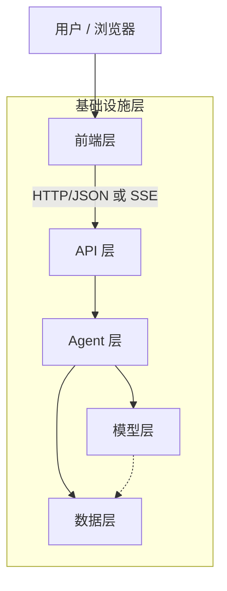
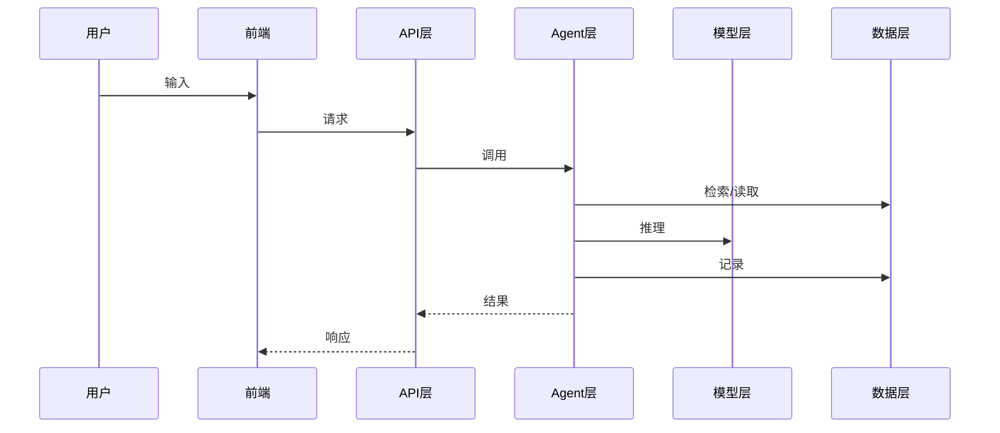

# Web 智能体技术架构设计模板（architecture.md）

> 适用对象：开发 **Web 形态智能体（AI Agent）** 的技术团队
> 使用方式：复制本模板，按章节填写。`【填写】` 为必填项，`【可选】` 按需填写，`> 提示` 为填写指导，提交前请删除提示行。
> 填写原则：**每一个技术选型都要写清“为什么选它”**；每一层都要说明“输入是什么、输出是什么、依赖谁”。

---

## 0. 文档信息

| 项目 | 内容 |
|---|---|
| 项目名称 | 【填写】 |
| 文档版本 | 【填写】如 v1.0 |
| 作者 / 小组 | 【填写】 |
| 指导教师 | 【填写】 |
| 最后更新 | 【填写】YYYY-MM-DD |
| 状态 | 草稿 / 评审中 / 已定稿 |

**修订记录**

| 版本 | 日期 | 修改人 | 修改内容 |
|---|---|---|---|
| v0.1 | | | 初稿 |

---

## 1. 项目概述

### 1.1 背景与目标
【填写】用 3~5 句话说明：解决什么问题、面向谁、智能体在其中扮演什么角色。

### 1.2 核心功能清单

| 编号 | 功能 | 优先级（P0/P1/P2） | 说明 |
|---|---|---|---|
| F-01 | 【填写】 | P0 | |

### 1.3 范围边界（做什么 / 不做什么）
> 提示：智能体项目必须写清能力边界，尤其涉及医疗、法律、金融等高风险领域。

- 做：【填写】
- 不做：【填写】

### 1.4 关键质量属性（非功能需求）

| 属性 | 目标值 / 要求 | 验证方式 |
|---|---|---|
| 响应时延 | 【填写】如 P95 < 8s | 压测 / 日志统计 |
| 可用性 | 【填写】 | |
| 安全与合规 | 【填写】 | |
| 可解释性 / 可追溯 | 【填写】 | |
| 成本 | 【填写】如单次调用 token 上限 | |

---

## 2. 开发与运行环境

### 2.1 程序设计语言及版本

| 用途 | 语言 | 版本 | 选择理由 |
|---|---|---|---|
| 后端 / Agent | 【填写】如 Python | 【填写】如 3.11 | |
| 前端 | 【填写】如 JavaScript / TypeScript | 【填写】 | |
| 其他（脚本/SQL） | 【可选】 | | |

### 2.2 开发工具（IDE 与辅助工具）

| 类别 | 工具 | 版本 | 用途 |
|---|---|---|---|
| IDE | 【填写】如 VS Code / PyCharm | | |
| IDE 插件 | 【可选】如 Python、ESLint、Prettier | | |
| 版本管理 | 【填写】如 Git + GitHub/Gitee | | |
| API 调试 | 【可选】如 Postman / Swagger UI | | |
| AI 辅助编程 | 【可选】 | | |

### 2.3 系统运行环境

| 环境 | 操作系统 | 运行时 | 硬件要求 | 说明 |
|---|---|---|---|---|
| 开发环境 | 【填写】Windows / macOS / Linux | 【填写】 | 【填写】CPU/内存/GPU | |
| 测试环境 | 【可选】 | | | |
| 生产环境 | 【填写】 | | | |

### 2.4 使用平台与外部服务

| 类别 | 平台 / 服务 | 用途 | 账号 / 计费方式 |
|---|---|---|---|
| 大模型平台 | 【填写】如 DeepSeek / 通义千问 / 文心 | | |
| 模型仓库 | 【可选】如 HuggingFace / ModelScope | | |
| 代码托管 | 【填写】 | | |
| 部署平台 | 【可选】云服务器 / 容器平台 | | |

### 2.5 依赖清单与版本锁定
> 提示：给出 `requirements.txt` / `package.json` 中的关键依赖，并**锁定版本**，保证可复现。

| 依赖 | 版本 | 所属层 | 用途 |
|---|---|---|---|
| 【填写】 | | | |

### 2.6 配置与密钥管理

| 配置项 | 说明 | 是否敏感 | 存放位置 |
|---|---|---|---|
| 【填写】如 `LLM_API_KEY` | | 是 | `.env`（不入库） |

---

## 3. 总体架构

### 3.1 分层架构图
> 提示：用 Mermaid 或图片描述六层架构及数据流向。



### 3.2 分层职责总览

| 层 | 主要职责 | 采用技术 | 对外接口 / 产出 |
|---|---|---|---|
| 前端层 | 【填写】 | 【填写】 | |
| API 层 | 【填写】 | 【填写】 | |
| Agent 层 | 【填写】 | 【填写】 | |
| 模型层 | 【填写】 | 【填写】 | |
| 数据层 | 【填写】 | 【填写】 | |
| 基础设施层 | 【填写】 | 【填写】 | |

### 3.3 核心请求时序
> 提示：描述一次典型请求从用户输入到返回结果的完整链路。



### 3.4 架构决策记录（ADR）

| 编号 | 决策 | 备选方案 | 选择理由 | 代价 / 风险 |
|---|---|---|---|---|
| ADR-01 | 【填写】 | | | |

---

## 4. 前端层（Presentation Layer）

### 4.1 主要职责
【填写】如：交互界面、输入采集与校验、结果渲染、状态展示、错误提示。

### 4.2 技术选型

| 类别 | 技术 | 版本 | 理由 |
|---|---|---|---|
| UI 框架 | 【填写】如 React / Vue | | |
| 构建工具 | 【填写】如 Vite | | |
| 组件库 / 样式 | 【可选】 | | |
| 状态管理 | 【可选】 | | |
| 网络请求 | 【填写】fetch / axios / SSE | | |

### 4.3 页面与组件结构

| 页面 / 组件 | 职责 | 关键 props / 状态 |
|---|---|---|
| 【填写】 | | |

### 4.4 与后端交互方式
【填写】同步请求 / 流式输出（SSE、WebSocket）；开发期代理配置；错误与超时处理。

### 4.5 智能体特有的 UI 设计要点
- 【填写】加载状态 / 流式打字效果
- 【填写】引用来源展示、风险提示、免责声明
- 【填写】用户反馈（点赞/点踩）入口

---

## 5. API 层（Interface Layer）

### 5.1 主要职责
【填写】如：路由、请求校验、鉴权、跨域、限流、异常统一处理、接口文档。

### 5.2 技术选型

| 类别 | 技术 | 版本 | 理由 |
|---|---|---|---|
| Web 框架 | 【填写】 | | |
| ASGI/WSGI 服务器 | 【填写】 | | |
| 数据校验 | 【填写】 | | |
| 鉴权 | 【可选】JWT / API Key | | |

### 5.3 接口清单

| 方法 | 路径 | 功能 | 请求体 | 响应体 | 鉴权 |
|---|---|---|---|---|---|
| GET | 【填写】 | | | | |
| POST | 【填写】 | | | | |

### 5.4 数据模型（Schema）
```text
【填写】核心请求/响应结构，如 Pydantic 模型或 JSON Schema
```

### 5.5 错误码规范

| HTTP 状态码 | 业务码 | 含义 | 前端处理 |
|---|---|---|---|
| 400 | 【填写】 | 参数错误 | |
| 500 | | 内部错误 | |
| 503 | | 模型服务不可用 | |

---

## 6. Agent 层（Orchestration Layer）

> 提示：这是智能体项目的**核心**，需重点设计。

### 6.1 主要职责
【填写】如：任务理解、流程编排、工具调用、上下文管理、安全护栏、结果后处理。

### 6.2 Agent 类型与编排模式
- 模式：【填写】固定流水线（Pipeline） / ReAct / Plan-and-Execute / 多 Agent 协作
- 选择理由：【填写】
- 编排框架：【填写】自研 / LangChain / LangGraph / LlamaIndex / AutoGen 等

### 6.3 处理流程（Pipeline / 状态图）
```text
【填写】如：输入 -> 预处理 -> 护栏 -> 检索 -> 推理 -> 后处理 -> 审计 -> 输出
```

### 6.4 模块划分

| 模块 | 职责 | 输入 | 输出 | 实现文件 |
|---|---|---|---|---|
| 【填写】 | | | | |

### 6.5 工具（Tools）定义【可选】

| 工具名 | 功能 | 参数 | 返回 | 调用条件 |
|---|---|---|---|---|
| 【填写】 | | | | |

### 6.6 记忆与上下文管理
- 短期记忆（会话上下文）：【填写】
- 长期记忆（用户画像/历史）：【可选】
- 上下文窗口控制策略：【填写】截断 / 摘要 / token 计数

### 6.7 提示词工程（Prompt Engineering）

| 提示词 | 用途 | 关键约束 | 存放位置 |
|---|---|---|---|
| System Prompt | 【填写】 | | |

### 6.8 安全护栏（Guardrails）

| 护栏 | 位置（输入/输出） | 规则 / 方法 | 触发后行为 |
|---|---|---|---|
| 【填写】如敏感信息脱敏 | 输入 | | |
| 【填写】如越权回答拦截 | 输入/输出 | | |
| 【填写】如提示注入防护 | 输入 | | |

---

## 7. 模型层（Model Layer）

### 7.1 主要职责
【填写】如：文本生成、语义向量化、（可选）重排序、意图分类。

### 7.2 模型选型

| 用途 | 模型 | 部署方式（API/本地） | 参数（温度、max_tokens 等） | 选择理由 |
|---|---|---|---|---|
| 生成模型 LLM | 【填写】 | | | |
| 嵌入模型 Embedding | 【填写】 | | | |
| 重排模型 Reranker | 【可选】 | | | |

### 7.3 模型访问封装
【填写】统一客户端封装、协议（如 OpenAI 兼容）、超时与重试、降级/备用模型。

### 7.4 成本与性能估算

| 项目 | 估算 |
|---|---|
| 单次请求平均输入/输出 token | 【填写】 |
| 预估日调用量 | 【填写】 |
| 预估费用 | 【填写】 |

---

## 8. 数据层（Data Layer）

### 8.1 主要职责
【填写】如：知识库存储、向量索引、业务数据、会话记录、日志审计。

### 8.2 数据存储选型

| 数据类型 | 存储技术 | 格式 | 生命周期 / 备份 | 理由 |
|---|---|---|---|---|
| 知识库原始文档 | 【填写】 | | | |
| 向量索引 | 【填写】FAISS / Chroma / Milvus / pgvector | | | |
| 业务 / 用户数据 | 【可选】SQLite / MySQL / PostgreSQL | | | |
| 日志 / 审计 | 【填写】 | | | |
| 缓存 | 【可选】Redis | | | |

### 8.3 知识库构建流程（RAG）
```text
【填写】文档采集 -> 清洗 -> 切分(chunk 策略) -> 向量化 -> 建索引 -> 检索(top-k) -> 引用
```

| 参数 | 取值 | 说明 |
|---|---|---|
| chunk 大小 / 切分规则 | 【填写】 | |
| 向量维度 | 【填写】 | |
| 相似度度量 | 【填写】 | |
| top-k | 【填写】 | |

### 8.4 数据模型 / 表结构
【填写】ER 图或表结构、日志记录字段。

### 8.5 数据安全与隐私
【填写】脱敏、加密、访问控制、数据保留期限、合规要求。

---

## 9. 基础设施层（Infrastructure Layer）

### 9.1 主要职责
【填写】如：运行环境、部署、配置、日志监控、CI/CD、安全。

### 9.2 部署架构

| 组件 | 部署方式 | 端口 | 实例数 |
|---|---|---|---|
| 【填写】 | 本地进程 / Docker / 云服务 | | |

### 9.3 配置管理
【填写】环境变量、多环境配置、密钥管理方式。

### 9.4 日志、监控与可观测性
【填写】应用日志、健康检查、调用链追踪、模型调用耗时与 token 统计。

### 9.5 CI/CD 与代码规范
【填写】分支策略、代码检查（lint/format）、自动化测试、构建发布流程。

---

## 10. 测试方案

| 测试类型 | 对象 | 工具 | 通过标准 |
|---|---|---|---|
| 单元测试 | 【填写】 | pytest / Vitest | |
| 接口测试 | 【填写】 | | |
| Agent 效果评测 | 【填写】准确率/引用正确率/拒答率 | 评测集 | |
| 安全测试 | 【填写】提示注入、越权、敏感信息 | | |
| 性能测试 | 【可选】 | | |

---

## 11. 风险与应对

| 风险 | 可能性 | 影响 | 应对措施 |
|---|---|---|---|
| 模型幻觉 | 【填写】 | | |
| 外部 API 不可用 | | | |
| 数据隐私泄露 | | | |

---

## 12. 项目结构与开发计划

### 12.1 目录结构
```text
【填写】
```

### 12.2 迭代计划

| 迭代 | 时间 | 目标 | 交付物 |
|---|---|---|---|
| Sprint 1 | 【填写】 | | |

---

## 附录
- A. 术语表：【填写】
- B. 参考资料：【填写】
- C. 设计自查清单：
  - [ ] 每一层都写清了职责、技术、版本和理由
  - [ ] 所有依赖都锁定版本
  - [ ] 密钥未写入代码与仓库
  - [ ] Agent 的能力边界与护栏已说明
  - [ ] 有可执行的测试与评测方案
